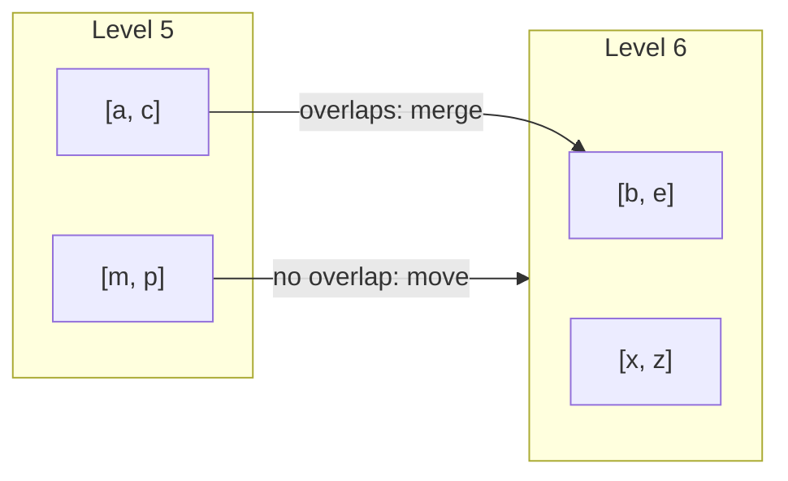

# Compaction

A **compaction** merges SSTables into a lower level. It removes old versions and deleted keys, and lowers the number of files that a read searches. Solarium compacts into the seven levels of RocksDB, with its dynamic level sizing. Up to `MaxBackgroundCompactions` compactions (1 by default) run at once, across all column families. Each one has a separate thread (`solarium-compaction-0`, `solarium-compaction-1`, and so on).

## The levels

- **Level 0** takes the flushed memtables. Its files can overlap. The newest file comes first.
- **Levels 1 to 6** hold sorted files. In each level, the files are in key order and share no key.

For each key, a version in a level is newer than every version in the levels below it.

## Level sizes

The levels are sized as with the `level_compaction_dynamic_level_bytes` of RocksDB, its default.

1. Level 6, the bottom level, has no target size.
2. Each level above it has a target of one `MaxBytesForLevelMultiplier`th (one tenth by default) of the level below.
3. Level 0 compacts into the **base level**: the highest level whose target is at most `MaxBytesForLevelBase` (256 MB). The base level is at or above the first level with files. This means that the levels above the base level are empty.

`LevelTargets` computes this as the `VersionStorageInfo::CalculateBaseBytes` of RocksDB.

The base level moves up as level 6 grows. The table shows two sizes of level 6 with the default options.

| Bytes in level 6 | Targets | Base level |
| --- | --- | --- |
| Less than 256 MB | none above level 6 | Level 6. Level 0 compacts directly into it. |
| 4.3 GB | 430 MB for level 5, 256 MB for level 4 | Level 4 |

## Scores

Each level of each column family has a **score**, as in RocksDB.

- Level 0: its file count divided by `Level0FileNumCompactionTrigger`.
- Each level from the base level to level 5: its bytes divided by its target.

The level with the highest score of at least 1, across all column families, goes first. The scores leave out the files that running compactions read.

## The kinds of compaction

### Level 0 into the base level

1. From the oldest level 0 file, the files that overlap neither each other nor a file of the base level **move** there as they are. One manifest save changes their level, and they keep their numbers.
2. The first file that overlaps ends this walk. This means that the level 0 files that remain are newer than the files that move.
3. If no file can move, the oldest file is **merged**. The merge takes the level 0 files that overlap it (and the files that overlap those), and the files of the base level in their range. It writes new files of the base level.

### A sorted level into the level below

The compaction takes one file: the file with the smallest overlap in the level below, relative to the size of the file. This is the default of RocksDB, `kMinOverlappingRatio`. It merges that file with the files of the level below that it overlaps.

A file that overlaps nothing in the level below moves down as it is. This is how an append-only key space, such as a Raft log, reaches level 6 with no rewrite.

## The merge

A merge reads all the versions of a key in the levels that it reads. Only the newest version of each key goes to the output, if no range tombstone of the inputs covers it. Older versions of the key can exist below the output level, and the output must include the markers that hide them.

- A **point delete** goes to the output only if the key range of a file of a lower level includes its key, as the `KeyNotExistsBeyondOutputLevel` of RocksDB asks.
- A **range tombstone** goes to the output only if a file below overlaps it.
- A merge into level 6 drops them all.

The range tombstones of the output are cut at the boundaries between the output files, as RocksDB truncates them. This means that the key range of each file covers its tombstones. The cut piece in a file ends at the first key of the next file, which is then the largest bound of the file, excluded. A table records when its largest bound is the end of a tombstone that none of its entries has (`TableProperties.LargestIsExclusive`). Two files of a level can then meet at that key, and they do not overlap.

A merge reads its inputs through table cursors that do not fill the cache. It reads 256 KiB of each file at a time from its first read. Each entry goes to the output table as spans. A value is copied directly from the block of the input into the block of the output, and no array is allocated between them. A flush takes its entries from the memory of the memtable in the same way.

A range where everything is deleted, and where the levels below need no tombstone, leaves no file. Output files end at `TargetFileSizeBase`, between two keys.

## Install

1. One manifest save replaces the inputs with the outputs.
2. A new version replaces the version of the column family.
3. A reader of an older version continues to read the files of that version.
4. A file that left the manifest is deleted when the last version that lists it closes.

A crash before the manifest save leaves the outputs as orphans. A crash after it leaves the inputs as orphans. The next open deletes them.

## DeleteFilesInRange

`DeleteFilesInRange` drops, in one manifest save, the files of levels 1 to 6 whose keys all lie in a range. It does not drop level 0 files or the files of a compaction in progress. The memtables do not change.

As in RocksDB, it ignores sequence numbers.

- A key of a dropped file is gone for later reads, even when no delete was written for it.
- A read or an iterator that started before the call continues to see it.
- An older version of a key, in a lower file that reaches past the range, can come back.

Kommander removes the dead prefix of a Raft log this way, with no rewrite. The files of one partition do not overlap, and they move down as they are. Each one is dropped when its last entry is below the compaction floor.

## CompactRange

`CompactRange` compacts the range one level after the other, as the manual compaction of RocksDB does.

1. The level 0 files in the range go into the base level.
2. Each level from the base level to level 5 goes into the level below, in the range.

It runs on the calling thread, and returns when the last compaction is installed. This means that a delete in the range reaches the bottom and drops what it hides. Level 6 files alone are not rewritten, as in RocksDB when there is no compaction filter.

A manual compaction runs alone, as with `exclusive_manual_compaction`, the default of RocksDB. While it waits, no automatic compaction starts. Each of its steps waits for the end of the other compactions.

## Several compactions at once

With `MaxBackgroundCompactions` above 1, compactions run side by side. The rules that separate them follow the compaction picker of RocksDB.

- A file that a running compaction reads is not picked again, as with `being_compacted` in RocksDB.
- A column family has one level 0 compaction at a time, because level 0 files overlap.
- A merge of level 0 waits while a file of the base level in its range is in a running compaction.
- A compaction into a level waits while a running compaction into that level writes an overlapping range, as with `RangeOverlapWithCompaction` in RocksDB. This means that their outputs do not overlap.

As a result, for each key, the versions in a level are always newer than those below. A merge into a level includes all the files of that level in its range, and no other compaction can move a version of those keys past it.

Each compaction has a separate install, in one manifest save under the state lock. It installs into the version that the installs of the others left.

With more threads, the stall time falls and the write amplification rises. The benchmarks measured this with random keys.

| | 1 thread | 6 threads | RocksDB |
| --- | ---: | ---: | ---: |
| Write amplification | 4.28 | 5.06 | 4.62 |
| Most level 0 files | 32 | 22 | 17 |
| Time that writes stalled | 3.5 s | 0 s | 131.8 s |

With one thread, the score of level 0 always wins, so each merge of level 0 takes many files at once. With more threads, the sorted levels compact as soon as they pass their targets, and each such merge rewrites about ten times its size from level 6, as in RocksDB.

The threads also write at the same time, just after the flushes, when synced writes need the drive. The order of the compactions does not change that: the scores of RocksDB for dynamic level sizing, tried in Solarium, gave the same synced rates. A rate limiter paces these writes. See [Paced writes](#paced-writes).

## Paced writes

A flush or a compaction writes its SSTable through a 1 MiB buffer, as the `WritableFileWriter` of RocksDB with its default `writable_file_max_buffer_size`. This gives one write for each megabyte. An unbuffered writer would make two writes for each block.

With a `RateLimiter`, the writer asks the limiter for the bytes of each write first, as with the `GenericRateLimiter` of RocksDB.

1. Each refill period (100 ms by default) hands out the rate times the period.
2. A flush asks at high priority, and a compaction at low priority. So the flushes are served first. On every tenth refill, the compactions are served first.
3. A write that finds the budget spent waits for the next refill.
4. A write larger than the budget of one period asks for its bytes in pieces.

An auto-tuned limiter starts at half its rate. Every 100 periods, it moves up by 5% when writes waited in more than 90% of the periods, and down by 5% when they waited in fewer than half. When no write waited, it drops to a twentieth of its rate.

The writer calls `IStorageFile.SyncRange` after each `BytesPerSync` bytes of a table (1 MiB once a `RateLimiter` is set). The table then reaches the drive in steps while it is written. One sync of the table at its end would hold up the WAL syncs of that moment. A failed range sync fails the write of the table, as the `RangeSync` of RocksDB does.

The WAL, the manifest, checkpoints, and the flushes of the WAL replay in `Open` are not paced. No other write shares the drive with the replay.

## Dispose and failures

`Dispose` stops the merges in progress, and deletes what each one wrote. A compaction failure, like a flush failure, stops all later writes until the database opens again. After a compaction fails, no other compaction installs. A merge that ends later deletes its outputs.
