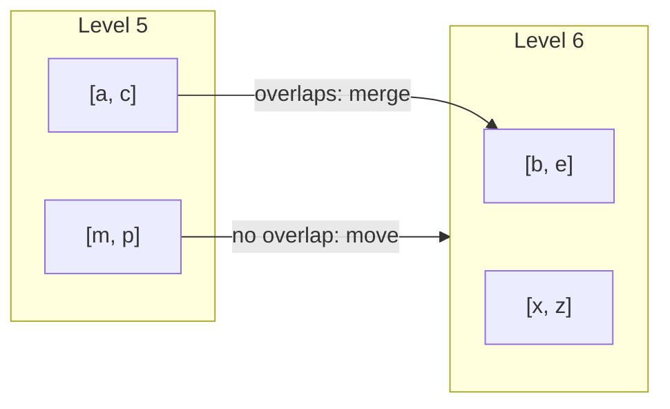

# Compaction

A **compaction** merges SSTables into a lower level. It removes old versions and deleted keys, and keeps the number of files that a read searches low. Solarium compacts into the seven levels of RocksDB, with its dynamic level sizing. One background thread, `solarium-compaction`, runs one compaction at a time across all column families.

## The levels

- **Level 0** holds the flushed memtables. Its files can overlap. The newest file comes first.
- **Levels 1 to 6** hold sorted files. In each level, the files are in key order and share no key.

For each key, every version in a level is newer than every version in the levels below it.

## Level sizes

The levels are sized as with the `level_compaction_dynamic_level_bytes` of RocksDB, its default:

1. Level 6, the bottom level, holds what it holds.
2. Each level above it has a target of one `MaxBytesForLevelMultiplier`th (one tenth by default) of the level below.
3. Level 0 compacts into the **base level**: the highest level whose target is still at most `MaxBytesForLevelBase` (256 MB). The base level is never below the first level with files, so the levels above the base level are empty.

`LevelTargets` computes this as the `VersionStorageInfo::CalculateBaseBytes` of RocksDB.

Examples:

| Bytes in level 6 | Targets | Base level |
| --- | --- | --- |
| Less than 256 MB | none above level 6 | Level 6. Level 0 compacts directly into it. |
| 4.3 GB | 430 MB for level 5, 256 MB for level 4 | Level 4 |

## Scores

Each level of each column family has a **score**, as in RocksDB:

- Level 0: its file count divided by `Level0FileNumCompactionTrigger`.
- Each level from the base level to level 5: its bytes divided by its target.

The level with the highest score of at least 1, across all column families, goes first.

## The kinds of compaction

### Level 0 into the base level

1. From the oldest level 0 file, the files that overlap neither each other nor a file of the base level **move** there as they are. One manifest save changes their level, and they keep their numbers.
2. The first file that overlaps ends this walk. So every file that stays in level 0 is newer than every file that moves.
3. If no file can move, the oldest file is **merged**. The merge takes every level 0 file that overlaps it (and the files that overlap those), and the files of the base level in their range. It writes new files of the base level.

### A sorted level into the level below

The compaction takes one file: the file whose overlap in the level below is smallest against its own size. This is the default of RocksDB, `kMinOverlappingRatio`. It merges that file with every file of the level below that it overlaps.

A file that overlaps nothing in the level below moves down as it is. This is how an append-only key space, such as a Raft log, reaches level 6 with no rewrite.

## The merge

A merge reads every version of a key in the levels that it reads. So it keeps only the newest version of each key, and only when no range tombstone of the inputs covers it. Below the output level, older versions of the key can still exist. So the merge keeps the markers that hide them:

- A **point delete** stays while a file of a lower level holds its key, as the `KeyNotExistsBeyondOutputLevel` of RocksDB asks.
- A **range tombstone** stays while a file below overlaps it.
- A merge into level 6 drops them all.

A range tombstone that stays is cut at the boundaries between the output files, as RocksDB truncates them. So the key range of each file covers its tombstones. The cut piece in a file ends at the first key of the next file, which is then the largest bound of the file, excluded. A table records when its largest bound is the end of a tombstone that none of its entries has (`TableProperties.LargestIsExclusive`). So two files of a level can meet at that key without overlapping.

A range where everything is deleted, and where nothing below needs a tombstone, leaves no file. Output files end at `TargetFileSizeBase`, between two keys.

## Install

1. One manifest save replaces the inputs with the outputs.
2. A new version replaces the version of the column family.
3. A reader of an older version continues to read the files of that version.
4. A file that left the manifest is deleted when the last version that lists it closes.

A crash before the manifest save leaves the outputs as orphans. A crash after it leaves the inputs as orphans. The next open deletes them.

## DeleteFilesInRange

`DeleteFilesInRange` drops, in one manifest save, the files of levels 1 to 6 whose keys all lie in a range. It leaves level 0, the memtables, and the files of a compaction that runs.

As in RocksDB, it ignores sequence numbers:

- A key of a dropped file is gone for later reads, even when no delete was written for it.
- Reads and iterators that started before the call still see it.
- An older version of a key, in a lower file that reaches past the range, can come back.

Kommander removes the dead prefix of a Raft log this way, with no rewrite. The files of one partition do not overlap, so they move down whole. Each one is dropped when its last entry is below the compaction floor.

## CompactRange

`CompactRange` compacts the range one level after the other, as the manual compaction of RocksDB does:

1. The level 0 files in the range go into the base level.
2. Each level from the base level to level 5 goes into the level below, in the range.

It runs on the calling thread, and returns when the last compaction is installed. So a delete in the range reaches the bottom and drops what it hides. As in RocksDB with no compaction filter, level 6 files alone are not rewritten. A compaction that runs finishes first.

## Dispose and failures

`Dispose` stops a merge that runs and deletes what it wrote. A compaction failure, like a flush failure, stops all later writes until the database opens again.

## One compaction at a time

RocksDB runs up to `max_background_compactions` compactions at a time, on files that no running compaction reads. Solarium runs one. Its effects in the benchmarks:

- The Raft log layout wrote zero bytes in compactions. One thread is enough for it.
- With random keys, Solarium wrote fewer bytes than RocksDB (write amplification 4.18 against 4.62), but its level 0 grew to 33 files against 17.
- Under heavy write loads, the work moves later: a full base level sets off merges during the next writes.

More than one compaction at a time is not done yet.
