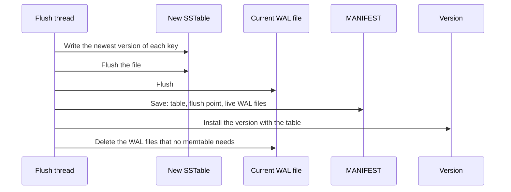

# Flushes

A **flush** writes an immutable memtable to a level 0 SSTable, so that its WAL files can be deleted. One background thread, `solarium-flush`, does all flushes. This page explains each step and why it is safe.

## The steps of a flush

1. **Switch.** A memtable that reaches `WriteBufferSize` becomes immutable at the next write group. `Flush` does the same at once. A new active memtable takes the writes.
2. **Write the table.** The flush thread writes the oldest immutable memtable to an SSTable and flushes the file.
3. **Flush the WAL.** The current WAL file is flushed.
4. **Save the manifest.** One manifest save records the table and the new flush point of the column family. It also drops the WAL files that no memtable needs.
5. **Install.** A new version replaces the memtable with the table. Then the dropped WAL files are deleted.

## What the flush writes

As in the flush of RocksDB with no snapshot, the flush writes only the newest version of each key. It drops a key that a newer range tombstone of the same memtable covers.

It keeps:

- the range tombstones, because they hide data in older tables;
- a point delete that no tombstone covers, for the same reason.

This is safe for readers:

- A reader that enters the new version takes its snapshot after the table is installed. Its snapshot is above every entry of the memtable, so it needs nothing that the flush dropped.
- A reader of the older version reads the memtable itself.

This keeps out of the SSTables the entries that die while still in memory. An example is the log rows of Kommander under a range tombstone that stays in the active memtable.

## Why the WAL flush comes before the manifest

A batch can span column families. The rest of the batch, or an earlier batch of another column family, can still be in the WAL only. Without step 3, a power loss could keep the new table but lose those writes. Then the database would show part of a batch.

So the current WAL file is flushed before the manifest save. No record before the table can be lost while the table survives. RocksDB syncs its closed WAL files before it commits a flush for the same reason. The older WAL files were flushed when they stopped being current.

## When writes wait for a flush

- When a column family holds `MaxWriteBufferNumber` memtables, a memtable switch waits for a flush.
- When the live WAL files are larger than `MaxTotalWalSize`, the column families that keep the oldest WAL file alive are flushed. This stops a column family with few writes from keeping old WAL files forever.

## The WAL file after a flush

A new WAL file starts at the first write group after a memtable switch, not at the switch. So after `Flush`, the WAL file changes at the next write group.

## Failures

A flush failure, like a WAL failure, stops all later writes until the database opens again. Reads continue. A crash before the manifest save leaves the new table as an orphan, and the next open deletes it. A crash after the save can leave old WAL files on disk. The next open replays them and skips the entries that an SSTable already holds.

## Flushes during recovery

At open, a memtable that fills during the WAL replay is written as a level 0 table at once, as in the recovery of RocksDB. So the WAL files do not need to fit in memory. The manifest saved at the end of the open records those tables.
