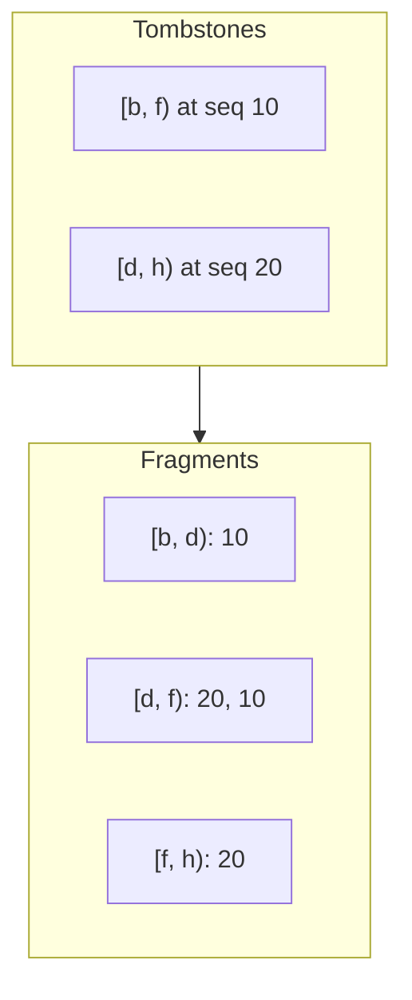

# Memtable

The **memtable** is the in-memory table of one column family. It holds the newest writes until a flush writes them to an SSTable. This page explains the skip list, how concurrent writers insert into it, and how it indexes range tombstones.

## A multi-version skip list

The memtable is a **skip list**: a sorted linked list with extra levels of links that skip ahead, so a search takes about log n steps. It holds entries in internal key order: the user key first, then the sequence number from the newest to the oldest. Each version of a key is its own entry.

The memtable follows the LevelDB design:

- Any number of readers walk the list with no lock.
- A node is fully built before a release-store or a compare-and-swap links it in.
- Nodes are never removed while the memtable lives. So a reader can walk the list while writers insert.

A reader sees a consistent state through sequence numbers, not through the list. The database publishes the last sequence number of a group only after every entry of the group is in. A reader skips entries newer than its snapshot.

## Concurrent inserts

The memtable takes either one writer at a time, or the writers of one group at once, never both:

- **One writer** links each new node in with a release-store.
- **Several writers** each link their own nodes with a compare-and-swap at each level, from the bottom level up. When a link changed under a writer, it searches only that level again. This is how the `InlineSkipList::InsertConcurrently` of RocksDB works.

In a group of several writers, the leader tells each writer that still spins to insert its own batch. It inserts the batches of the writers that blocked. A blocked writer would need to wake and get a CPU before it could insert, and that would delay the whole group. See [Write Path](write-path.md).

## Memory

The skip list lives in **native memory**, outside the managed heap, as the `InlineSkipList` of RocksDB lives in its arena:

- Each node is one allocation. It holds a header (the sequence number, the lengths, the kind, and the height), then its links as addresses, then the key and the value. So a key compare reads the node that the search just reached.
- An **arena** cuts the nodes from chunks of 64 KiB. While a group inserts at once, each writer uses a chunk of its own processor. A value larger than 16 KiB gets a block of its own.
- A write copies its key and value in. A read copies them out into new arrays, as a read of an SSTable does.

The garbage collector sees no entry. No collection copies or marks the memtable, and the memtable does not count against the heap limit of the GC.

The size of a memtable counts its nodes: each key and value, a 24-byte header, and 8 bytes for each level of links, rounded up to 8. It also counts the fragments of its range tombstones. When the size reaches `WriteBufferSize`, the memtable becomes immutable at the next write group. A `WriteBufferManager` counts the same size, across databases. After the inserts of each group, the leader of the stage charges the bytes that the group added, once for each group and not for each entry.

The chunks of a flushed memtable go back to a pool: that of the `WriteBufferManager`, or one that the databases without a manager share. The pool keeps them for the next memtables while the chunks that it holds stay within the memtable budget. So a new memtable writes to pages that are mapped already. Besides the budget, the process holds at most one partly used chunk for each processor and memtable.

A memtable is freed when its last holder releases it. Every version that lists it holds it, and so does a flush that waits to write it. Every reader is counted in a version, so a reader, an iterator included, never sees its memory go. A database that closes refuses the readers that come after, with `ObjectDisposedException`. An iterator that is still open keeps its memtables until you dispose it.

## Range tombstones

A **range tombstone**, from `DeleteRange`, hides every older version of the keys in its range. A read of a key must find the tombstones that cover it. With many tombstones, a scan of all of them is slow. RocksDB and Solarium both cut the tombstones into **fragments**: ranges that do not overlap, each with the sequence numbers of the tombstones over it. A read does a binary search for the fragment of its key, then takes the highest sequence number at or below its snapshot.

### In the memtable: runs that double

The tombstones of a memtable change with each range delete. RocksDB caches the fragments of all of them until the next range delete, so the first read after each range delete fragments them all again. With 8,192 tombstones, that read pays for 8,192 tombstones.

Solarium makes the writer build the fragments instead, in **runs**:

1. Range tombstones go into an array that only grows. Each range delete publishes a new set over a longer prefix of the array, so the set that a reader holds never changes.
2. When 8 tombstones are past the last run, the writer builds them into a new run.
3. It merges into the new run the runs before it that are no larger, as a binary counter carries.
4. So the runs have sizes of 8, 16, 32, and more tombstones, one of each size at most.

A lookup searches each run with a binary search, and scans the fewer than 8 tombstones past the last run. No reader builds anything.

The cost moves to the writer: each tombstone takes part in one build each time the count of tombstones doubles. The largest build, of all the tombstones, comes on the range delete that makes the count 8 times a power of two.

In the benchmarks, a pair of one `DeleteRange` and one `Get` or `Seek` costs 3 to 12 µs at every tombstone count. With the RocksDB approach, it cost 2 ms at 8,192 tombstones.

### Concurrent range deletes

When several writers of a group add range deletes at once, the range deletes go to a copy-on-write array under a small lock, not to a second skip list.

## After a flush

A flush writes only the newest version of each key, and drops a key that a newer range tombstone of the same memtable covers. So entries that die while still in memory never reach an SSTable. See [Flushes](flushes.md).
