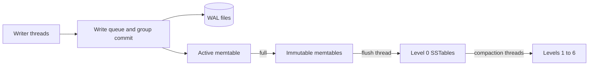
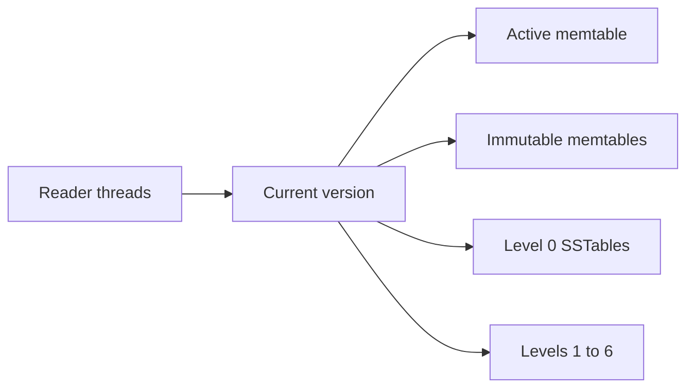

# Architecture Overview

Solarium is a **log-structured merge-tree** (LSM tree): a store that writes changes to a log and to memory first, and then merges them into sorted files on disk in the background. This page shows the parts of the engine and how they connect. The other architecture pages explain each part in detail.

## The parts

A write goes through the write queue to the WAL and the active memtable. Background threads then flush the memtable and compact the SSTables:

A read takes the current version of a column family, and searches its sources from the newest to the oldest:

The manifest records the live files, and the storage environment does all file I/O.

| Part | Role | Details |
| --- | --- | --- |
| **Write queue** | Groups concurrent writers. A leader writes their records to the WAL in one append. | [Write Path](write-path.md) |
| **WAL** | One log for all column families. One record holds one whole batch. | [WAL and Recovery](wal-and-recovery.md) |
| **Memtable** | A lock-free skip list in memory, one active for each column family. | [Memtable](memtable.md) |
| **Version** | An immutable list of the memtables and SSTables of a column family. A read uses one version. | [Read Path](read-path.md) |
| **Flush thread** | Writes immutable memtables to level 0 SSTables. | [Flushes](flushes.md) |
| **Compaction threads** | Merge and move SSTables down the seven levels, up to `MaxBackgroundCompactions` at once. | [Compaction](compaction.md) |
| **SSTable** | An immutable sorted file with data blocks, and an index and Bloom filters cut into partitions. | [SSTables](sstables.md) |
| **Block cache** | Optional. Holds the index and filter partitions of the SSTables, and can hold the memtable budget too. | [Block Cache and Memtable Budget](../guides/memory.md) |
| **Manifest** | The list of live WAL files, column families, SSTables, and flush points. | [Data Directory](../reference/data-directory.md) |
| **Storage environment** | All file I/O: default or io_uring. | [Storage Environments](storage-environments.md) |

## Sequence numbers

Every operation of every batch gets a **sequence number**. All column families share one sequence. A batch takes consecutive numbers: operation `i` of a batch has the number `first + i`.

Sequence numbers do three jobs:

- **Order.** For each key, a higher sequence number is a newer version.
- **Visibility.** The database publishes the last sequence number of a group after every entry of the group is in the memtables. A read takes the last published number as its snapshot and skips newer entries.
- **Recovery.** The flush point of each column family, in the manifest, is a sequence number. At open, the WAL replay skips entries at or below it.

## Internal keys

The memtables and SSTables store **internal keys**: the user key, the sequence number, and the kind (put, delete, or range delete). Internal keys sort by the user key first, then by the sequence number from the newest to the oldest. So the versions of one key are next to each other, the newest first.

## Versions

Each column family has a **version**, like the `SuperVersion` of RocksDB. A version lists:

- the active memtable;
- the immutable memtables that wait for a flush;
- the SSTables of each level.

A version never changes after it is published. A memtable switch, a finished flush, or a finished compaction publishes a new version. Readers count themselves into the version that they read, and out when they are done. A file stays open until the last version that lists it has no readers and is replaced.

## Threads

| Thread | Work |
| --- | --- |
| Your writer threads | One of them leads each write group. Each one inserts its own batch into the memtable. |
| Your reader threads | Reads take no engine locks. With a block cache, a lookup takes the lock of one cache shard. |
| `solarium-flush` | One background thread for all flushes. |
| `solarium-compaction-0`, `-1`, ... | One thread for each of the `MaxBackgroundCompactions` compactions that can run at once, across all column families. The default is 1. |
| The io_uring reactor | Only with the io_uring storage environment: one reactor thread for the reads and writes. |

## Locks

| Lock | Protects |
| --- | --- |
| The write lock | The write queue. |
| The state lock | Memtable switches, flush installs, compaction installs, and manifest changes. |
| The directory `LOCK` file | The directory, against a second process. |

Reads take none of these locks. A block cache has a lock for each of its shards, and a lookup in the cache takes one of them.

## Where Solarium follows RocksDB, and where it does not

The design follows RocksDB in each part: group commit with pipelined writes, the skip-list memtable, the `SuperVersion`, leveled compaction with dynamic level sizing, a rate limiter for flush and compaction writes, fragmented range tombstones, and the property names. The main differences are:

- one thread for each merge (no subcompactions), and one flush thread;
- a block cache for index and filter blocks only;
- a WAL record with a durable offset;
- a manifest that is written again whole on each change.

[Differences from RocksDB](../reference/rocksdb-differences.md) lists every difference.
