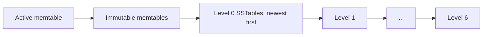

# Read Path

A read in Solarium takes no engine locks. It takes the current version of the column family and a snapshot, and then searches the sources of the version from the newest to the oldest. This page explains why that gives a correct answer, and how readers keep files alive.

## Version, then snapshot

A read takes two things, in this order, as in RocksDB:

1. The **version** of the column family: the memtables and SSTables that it searches.
2. The **snapshot**: the last published sequence number.

The order matters. A version never loses data that its own snapshot can see. A newer version can lose it, because a compaction installed later can drop old versions of keys. So the read takes the version first, and only then a snapshot that is at least as new.

The snapshot can be newer than the memtables of the version. That is safe: a memtable switch splits the sequence numbers at one point. Entries above the snapshot are skipped, and entries at or below it are all in the version. So the read sees the whole state at one sequence number.

## Search order

A read searches the sources of the version, newest first:

- Each memtable is one source.
- Each level 0 SSTable is one source, because level 0 files can overlap.
- Each of levels 1 to 6 that has files is one source, because its files are in key order and do not overlap. A read does a binary search for the one file that can hold the key.

Within one column family, for each key, every version of the key in a newer source has a higher sequence number than every version in an older source. The same is true of the range tombstones over the key. So **the first source with a version of the key decides the result**:

- a put: the read returns its value;
- a delete, or a range tombstone that covers the key: the read returns null.

In each source, the read skips versions and range tombstones above its snapshot.

## Index partitions and Bloom filters

Each SSTable cuts its index into partitions of about 4 KB of index entries. Each partition has a Bloom filter on the user keys of its data blocks: 10 bits for each key and 7 probes, which gives about 1% false positives. A small top-level index holds the last key of each partition.

A lookup in a table takes three steps:

1. It searches the top-level index for the partition whose last key is at or after its key.
2. It checks the filter of that partition. A key that is not in the table usually stops here, with no block read.
3. It searches the index of the partition for the data block, and reads the block.

Without a block cache, the partitions stay in memory while the table is open. With `CacheIndexAndFilterBlocks`, they are in the block cache (see [Caches](#caches)).

## MultiGet

`MultiGet` reads in rounds, as the batched `MultiGet` of RocksDB, over batches of up to 32 keys:

1. A round searches the sources of each key from where it stopped. It stops when a memtable answers, or when a table index names the data block that would hold the key.
2. It reads the distinct blocks of the round, which keys often share, in one `IStorageEnvironment.MultiRead`.
3. It settles each key that its block has a version of. A key whose block has none, after a false positive of a Bloom filter, goes on to the next source in the next round.

Most calls take one round. On io_uring, the reads that the page cache misses are in flight together, so the drive serves them at once. See [Storage Environments](storage-environments.md#batch-reads).

## Iterators

An iterator merges one cursor for each source:

- **Forward.** Each step takes the smallest key under any cursor, and moves every cursor past it. The step skips deleted keys, keys under a range tombstone, and versions above the snapshot.
- **Backward.** Each step asks each source for its largest key below the current key, and looks up the winner. So a step costs a search in every source, and `Prev` is slower than `Next`.

An iterator keeps the snapshot and the version of its creation. A later flush or compaction does not change what it sees. It keeps the SSTables of that version open until you dispose it.

## Reader counts

A reader counts itself into the version that it reads, and out when it is done. An iterator counts itself out when you dispose it.

- A table stays open until the last version that lists it has no readers and is replaced.
- A file that left the manifest is deleted when the last version that lists it closes. That can happen on the thread of the last reader.
- The counts are kept for each CPU. Readers on different CPUs do not share a cache line, so they do not slow each other down.

The read takes no lock to get its version. It reads the current version with a volatile read, counts itself in with an atomic operation, and checks that the version is still current. If a new version replaced it in that time, the read counts itself out and tries again.

## Caches

**Data blocks** go to the block cache of the column family only with `CacheDataBlocks`, which is off by default. Without it, each data block that a read needs is read from the file through the storage environment, and the page cache of the operating system is the only cache. A compressed block is decompressed on each read. In the Kahuna benchmarks, with the tables in the page cache, reads matched or beat RocksDB with its block cache. See [Benchmarks](../operations/benchmarks.md).

With `CacheDataBlocks`:

- A read looks up the block in the cache, keyed by the owner number of the database, the number of the table, and the offset of the block. A cached block makes no system call and decompresses nothing.
- A miss reads, verifies, and decompresses the block, then caches it in native memory, unless `ReadOptions.FillCache` is false.
- A read holds a reference to the cached block from its lookup to the end of its decode. An eviction leaves the bytes to the last reader, which frees them. So a read never sees the memory of its block go.
- `Get`, iterators, and the rounds of `MultiGet` use the cache. In a `MultiGet` round, a cached block settles its keys without joining the `MultiRead` of the round.
- Compactions read with `FillCache` off, so their inputs do not push out the blocks of the readers.
- The data blocks of a retired table stay until the LRU evicts them. A database that closes erases every entry under its owner number.

**Index and filter partitions** go to the block cache of the column family with `CacheIndexAndFilterBlocks`:

- A table puts every partition in the cache when it opens, and keeps only its top-level index.
- A lookup takes its partition from the cache, under the lock of one shard.
- After an eviction, a lookup reads the two blocks of the partition again from the file, verifies them, and caches them, unless `ReadOptions.FillCache` is false.
- A reader that took a partition keeps it after an eviction. The blocks of a table never change, and the garbage collector frees them after the last reader. So a read holds no reference in the cache.
- With `PinL0FilterAndIndexBlocksInCache`, a level 0 table pins its partitions until a move takes it out of level 0.
- A table that closes erases its partitions. So a cache that several databases share holds only open tables.

Each shard of the cache keeps a high-priority pool, up to `HighPriorityPoolRatio` of the shard, for the index and filter partitions and each entry read again after its insert. Another pool holds the rest. An entry that overflows the high-priority pool moves to the newest end of the other pool, so the two keep one LRU order. An eviction takes from the low-priority pool first. So the blocks of a scan, each read once, do not push out the indexes or the blocks read often.

See [Block Cache and Memtable Budget](../guides/memory.md).
