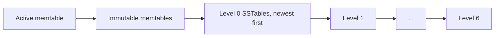

# Read Path

A read in Solarium takes no locks. It takes the current version of the column family and a snapshot, and then searches the sources of the version from the newest to the oldest. This page explains why that gives a correct answer, and how readers keep files alive.

## Version, then snapshot

A read takes two things, in this order, as in RocksDB:

1. The **version** of the column family: the memtables and SSTables that it searches.
2. The **snapshot**: the last published sequence number.

The order matters. A version never loses data that its own snapshot can see. A newer version can lose it, because a compaction installed later can drop old versions of keys. So the read takes the version first, and only then a snapshot that is at least as new.

The snapshot can be newer than the memtables of the version. That is safe: a memtable switch splits the sequence numbers at one point. Entries above the snapshot are skipped, and entries at or below it are all in the version. So the read sees the whole state at one sequence number.

## Search order

A read searches the sources of the version, newest first:

- Each memtable is one source.
- Each level 0 SSTable is one source, because level 0 files can overlap.
- Each of levels 1 to 6 that has files is one source, because its files are in key order and do not overlap. A read does a binary search for the one file that can hold the key.

Within one column family, for each key, every version of the key in a newer source has a higher sequence number than every version in an older source. The same is true of the range tombstones over the key. So **the first source with a version of the key decides the result**:

- a put: the read returns its value;
- a delete, or a range tombstone that covers the key: the read returns null.

In each source, the read skips versions and range tombstones above its snapshot.

## Bloom filters

Each SSTable has a Bloom filter on its user keys: 10 bits for each key and 7 probes, which gives about 1% false positives. A read checks the filter before it reads a data block. A key that is not in the table usually costs no block read. The filters stay in memory while the table is open.

## Iterators

An iterator merges one cursor for each source:

- **Forward.** Each step takes the smallest key under any cursor, and moves every cursor past it. The step skips deleted keys, keys under a range tombstone, and versions above the snapshot.
- **Backward.** Each step asks each source for its largest key below the current key, and looks up the winner. So a step costs a search in every source, and `Prev` is slower than `Next`.

An iterator keeps the snapshot and the version of its creation. A later flush or compaction does not change what it sees. It keeps the SSTables of that version open until you dispose it.

## Reader counts

A reader counts itself into the version that it reads, and out when it is done. An iterator counts itself out when you dispose it.

- A table stays open until the last version that lists it has no readers and is replaced.
- A file that left the manifest is deleted when the last version that lists it closes. That can happen on the thread of the last reader.
- The counts are kept for each CPU. Readers on different CPUs do not share a cache line, so they do not slow each other down.

The read takes no lock. It reads the current version with a volatile read, counts itself in with an atomic operation, and checks that the version is still current. If a new version replaced it in that time, the read counts itself out and tries again.

## No block cache

Solarium has no block cache. Each block that a read needs is read from the file through the storage environment, and the page cache of the operating system is the only cache. A compressed block is decompressed on each read.

In the Kahuna benchmarks, with the tables in the page cache, reads matched or beat RocksDB with its block cache. See [Benchmarks](../operations/benchmarks.md).
