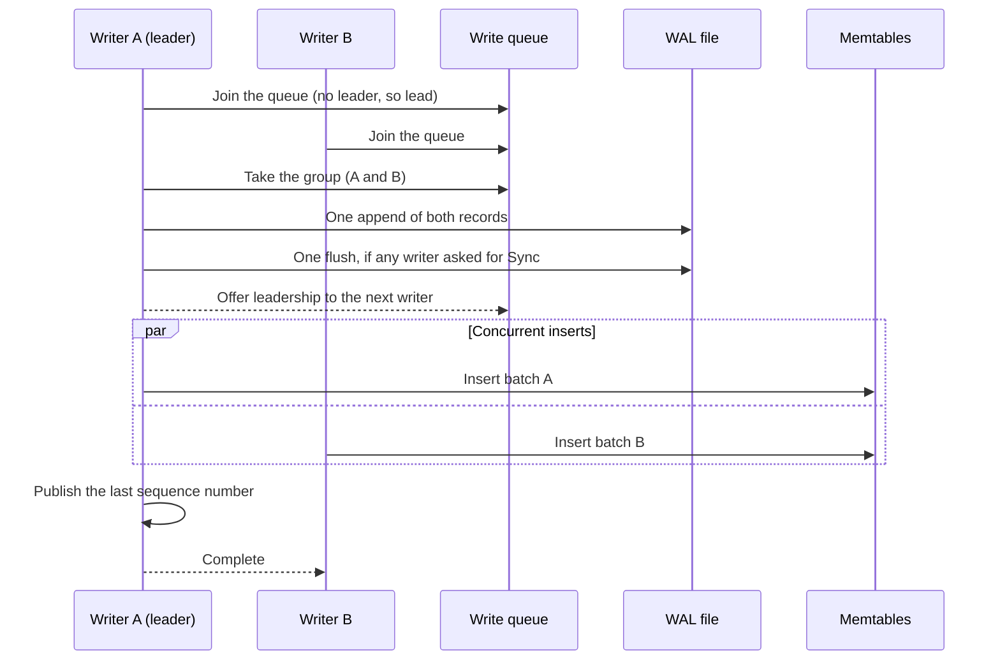

# Write Path

A write in Solarium goes through **group commit**: concurrent writers form a group, and one **leader** writes the records of the whole group to the WAL in one append. Then the writers of the group insert their batches into the memtables in parallel. This page explains each step.

## The steps of a write

1. **Encode.** A writer encodes its batch into a WAL record, without the sequence numbers. It notes the column families that the batch writes to. Then it joins the write queue. When no leader is active, it becomes the leader.
2. **Take the group.** The leader takes the queue as its group, from the front, up to `MaxWriteBatchGroupSizeBytes` of records. The batch of the leader always goes, so a larger batch is a group of its own. When the batch of the leader is at most one eighth of the cap, the group stops at the size of that batch plus one eighth, as in RocksDB. This keeps a small write from waiting for a large group.
3. **Switch memtables.** The leader switches every full memtable of the column families that the group writes to.
4. **Append.** The leader copies the records of the writers into one buffer. It gives each record its first sequence number and its checksum, and writes them to the WAL in one append. If any writer asked for `Sync`, it flushes the WAL once.
5. **Offer leadership.** The leader offers leadership to the oldest writer in the queue, if there is one. So the WAL append of the next group runs while this group goes into the memtables. This is the `enable_pipelined_write` of RocksDB.
6. **Wait for the memtable stage.** One memtable stage runs at a time. A group that finds none running starts one at once. Otherwise it joins a memtable queue, in WAL order. When a stage ends, it offers the next stage to the leader of the oldest group in the queue, and that stage takes every group in the queue.
7. **Insert.** The batches of the stage go into the active memtables, each operation under the sequence number of its WAL record. In a stage of several writers, the leader tells each writer that still spins to insert its own batch. It inserts its own batch and the batches of the writers that blocked. Then it waits for the last insert, as with the `allow_concurrent_memtable_write` of RocksDB.
8. **Publish.** The leader of the stage publishes the last sequence number of the stage. This makes its groups visible to reads at once, and groups become visible in WAL order. Then it completes each writer of the stage.

## Why the steps are in this order

- **One append for many writers.** A device flush takes milliseconds. Sixteen synced writers in one group pay for one flush, not sixteen.
- **Pipelining.** The next group can write to the WAL while this group inserts into the memtables. In the `Put` benchmarks, pipelining made 3 to 16 unsynced writers 5% to 15% faster.
- **Parallel inserts.** Each writer reads its own batch from the cache of its own core. The inserts do not run one at a time on the path of the leader.
- **Publication in WAL order.** A read never sees a group before a group that is earlier in the WAL. So the state that a read sees is always a prefix of the WAL.

## Safety rules

- **Memtable switches wait for publication.** The leader of a stage holds the lock that a memtable switch takes, from the inserts to the publication. So a `Flush` cannot switch a memtable while writers fill it.
- **WAL files close after publication.** A WAL file stops being current only after every group appended to it is published. So a flush never deletes a WAL file whose data is not in a memtable yet.
- **A failed insert fails the database.** If an insert fails, the group fails, and the database refuses all writes until it opens again. The WAL holds the whole group, but part of it is in the memtables under sequence numbers that were never published.

## Waiting writers

A writer in the queue waits on its own signal, as in RocksDB. The end of a group wakes only the writers of the group and the oldest writer in the queue.

A waiting writer **spins** for up to 20 µs before it blocks, so it seldom needs a thread wake. A thread wake takes time on the path of the group. The spin adapts:

- While most spins end in time, every turn spins for 20 µs. One turn in 256 is a **probe**. Its result, in time or a block, updates a credit that the database keeps.
- When more than about a quarter of the probes block, the other turns spin for 1 µs only. A long spin then holds a CPU that the leader, its hyperthread sibling, or the I/O thread of the storage environment needs, and the writer blocks anyway.
- While the spin is short, the probes run in windows: once in 8,192 turns, 256 turns spin for 20 µs, and the last 128 of them are probes. The long spin comes back when it ends in time again.
- A new database starts with the long spin and a margin of credit: 16 probes that block in a row make the spin short.

A writer that waits for a WAL flush blocks at once, because the flush takes far longer than the spin.

## The offer of leadership

The offer of leadership is not a hand-off, unlike in RocksDB. A writer that arrives while no leader is active takes the queue and leads it. The writer that got the offer then waits for that group. A running writer starts the next group sooner than a blocked writer can wake up.

The leader makes the offer under the write lock, while the writer is still the oldest in the queue, and wakes it after the release. An offer after the release could reach a writer that left the queue since then. That writer waits for its own memtable stage, and it would read the offer as the offer of that stage.

## Write stalls

Before it appends its group, a WAL leader checks the write stall state. In a delay, it pays credit from a bucket that refills at `DelayedWriteRate`. In a stop, it waits for a flush or a compaction. See [Write Stalls](../operations/write-stalls.md).

## What a write survives

A write that is not synced survives a process crash, but not a power loss, as in RocksDB. After a clean close, it survives a power loss too, because `Dispose` flushes the current WAL file. See [Durability](../operations/durability.md).
