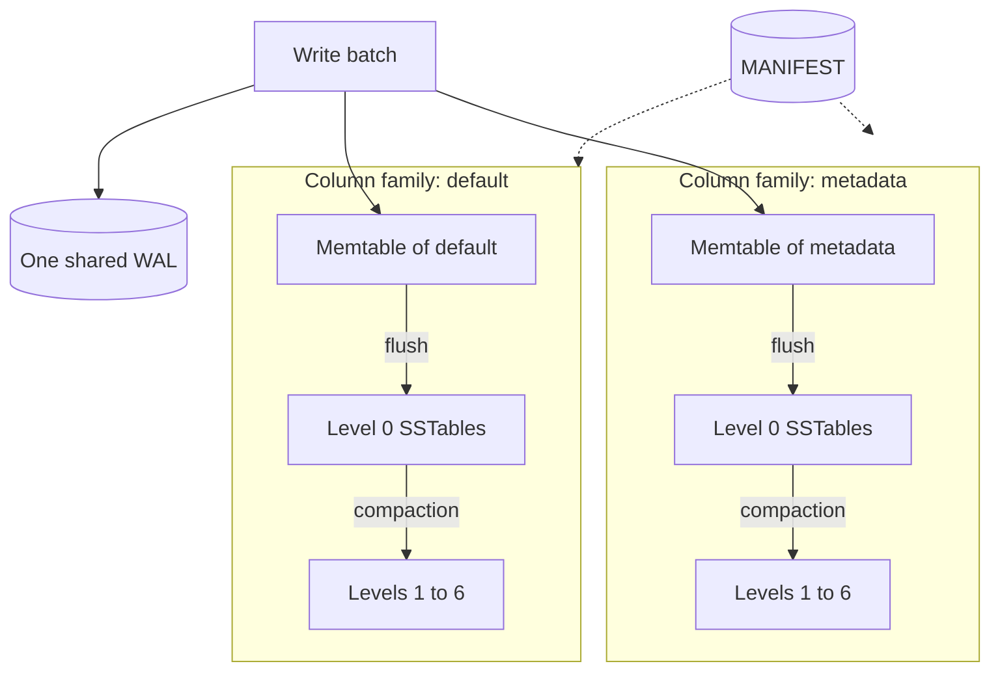

# Key Concepts

Solarium is a log-structured store. Words such as WAL, memtable, SSTable, compaction, and range tombstone appear across these docs, in the options, and in the properties that the database reports. When you know them, you can predict what a write survives, why a write slows down, and when disk space comes back.

Each term gets a short definition, a comparison with a familiar tool where that helps, and a link to the page with the details.

## The big picture

A database with two column families looks like this:

A batch goes to the WAL first, as one record. Then each of its operations goes to the memtable of its column family. Each column family flushes and compacts its own files. The manifest records which files are live.

## Data model

### Database and data directory {#database}

A database is one directory on disk. Your process opens it with `SolariumDb.Open`, and reads and writes it directly, like a SQLite file. There is no server. Only one open database can use a directory at a time, because `Open` takes the `LOCK` file. See [Data Directory](reference/data-directory.md).

### Key and value {#key-and-value}

A key and a value are byte arrays. Keys sort by their bytes, so `log:0002` comes before `log:0010`, but `log:2` comes after `log:10`. Use fixed-width ids, such as zero-padded numbers, when you want them to sort in numeric order.

### Column family {#column-family}

A column family is a named, ordered key space inside one database. It is like a separate table in one SQLite file. Each column family has its own memtables, its own SSTables, and its own options. All column families share one WAL, so one batch can write to several of them atomically. See [Column Families](guides/column-families.md).

### Write batch {#write-batch}

A write batch is a group of puts, deletes, and range deletes that lands whole, or not at all. It is like a database transaction that only writes. Every write in Solarium is a batch: `Put` on the database is a batch of one operation. See [Writes and Batches](guides/writes-and-batches.md).

### Sequence number {#sequence-number}

Every operation of every batch gets a sequence number, from one counter that only grows. All column families share it. For each key, a higher sequence number is a newer version. A batch takes consecutive numbers. See [Architecture Overview](architecture/overview.md#sequence-numbers).

### Snapshot {#snapshot}

A snapshot is the sequence number that a read sees the database at. A read takes the latest published sequence number. It sees every write at or below that number, and no write above it. So a read never sees part of a batch. See [Reads and Iterators](guides/reads-and-iterators.md#snapshots).

### Iterator {#iterator}

An iterator is an ordered cursor over one column family at one snapshot, like a `SortedDictionary` enumerator that ignores later changes. It can seek, step forward, step back, and stop at an upper bound. An iterator keeps the files of its snapshot on disk until you dispose it. See [Reads and Iterators](guides/reads-and-iterators.md#iterators).

## Durability

### Write-ahead log {#wal}

The write-ahead log (WAL) is a file that only grows. Every batch goes to it as one record before it goes to a memtable. After a crash, the open replays the WAL to rebuild what was in memory. All column families share one WAL. See [WAL and Recovery](architecture/wal-and-recovery.md).

### Fsync and the page cache {#fsync}

When a process writes to a file, the operating system first keeps the bytes in memory, in the page cache. An fsync, or a flush to the device, tells the operating system to write them to the drive and wait. An fsync takes far longer than a write to the page cache. Solarium never caches SSTable data blocks itself, so the page cache is their only cache. See [Tuning](operations/tuning.md#memory).

### Synced and unsynced write {#synced-and-unsynced-write}

A synced write (`WriteOptions.Synced`) flushes the WAL to the device before `Write` returns. An unsynced write, the default, returns when the record is in the page cache.

### Process crash and power loss {#process-crash-and-power-loss}

The two failures differ in what they can lose:

| Event | Synced write | Unsynced write |
| --- | --- | --- |
| Process crash, after `Write` returns | Survives | Survives |
| Power loss, after `Write` returns | Survives | Can be lost |
| Power loss, after a clean `Dispose` | Survives | Survives |

A process crash leaves the page cache in place, so the operating system still writes the record. A power loss can lose any sector written since the last fsync. See [Durability](operations/durability.md).

### Group commit {#group-commit}

Group commit lets many writer threads share one WAL append and one fsync. Concurrent writers form a group, and one leader writes the records of the whole group. Sixteen synced writers in one group pay for one fsync, not sixteen. See [Write Path](architecture/write-path.md).

### Recovery and the durable offset {#recovery}

At open, Solarium replays the WAL files in order. Each WAL record carries a durable offset: how much of its file an fsync made durable when the record was appended. With it, recovery tells the damage that a crash or a power loss can leave from damage that no crash explains. Recovery cuts a torn tail of the newest WAL file. It refuses to open for damage that no crash explains, and drops no data. RocksDB has no such field. See [WAL and Recovery](architecture/wal-and-recovery.md#recovery-rules).

## Storage on disk

### Memtable {#memtable}

A memtable is a sorted structure in memory, a lock-free skip list, that holds the newest writes of one column family. Reads search it with no lock. When it reaches `WriteBufferSize`, it becomes immutable, and a new active memtable takes the writes. See [Memtable](architecture/memtable.md).

### Flush {#flush}

A flush writes an immutable memtable to disk as a level 0 SSTable. After the flush, the WAL files that no memtable needs are deleted. One background thread does all flushes. This flush is different from a flush to the device: it moves data from memory to a new file. See [Flushes](architecture/flushes.md).

### SSTable {#sstable}

A sorted string table (SSTable) is a file of sorted keys and values that never changes after it is written. It holds data blocks, an index of the blocks, and Bloom filters that skip files without the key. The index and the filters are cut into partitions of about 4 KB. A compaction replaces SSTables. It never edits them. See [SSTables](architecture/sstables.md).

### Level {#level}

Each column family keeps its SSTables in seven levels, 0 to 6:

- **Level 0** holds the flushed memtables. Its files can overlap.
- **Levels 1 to 6** hold sorted files. In each level, the files share no key.

For each key, every version in a level is newer than every version in the levels below it. Level 6 is the bottom level, and it holds most of the data. See [Compaction](architecture/compaction.md#the-levels).

### Compaction {#compaction}

A compaction merges SSTables into the level below. It keeps the newest version of each key, and drops old versions and deleted keys. So a read searches fewer files, and disk space comes back. Compactions run on background threads, up to `MaxBackgroundCompactions` at once. Each merge runs on one thread. See [Flushes and Compaction](guides/flushes-and-compaction.md#compaction).

### Trivial move {#trivial-move}

A trivial move takes a file that overlaps nothing in the level below, and moves it down as it is. It costs one manifest save and no rewrite. A Raft log appends keys that grow, so its files reach level 6 this way, with no compaction writes. See [Trivial moves](guides/flushes-and-compaction.md#trivial-moves).

### Manifest {#manifest}

The manifest is the file `MANIFEST`. It lists the live WAL files, the column families, the SSTables of each level, and the flush point of each column family. Each change writes a new manifest and replaces the old one atomically. See [Data Directory](reference/data-directory.md#manifest).

### Version {#version}

A version is an immutable list of the memtables and SSTables of a column family, like the `SuperVersion` of RocksDB. A read uses one version from start to end. A flush or a compaction publishes a new version, and a file stays on disk until no version that lists it has readers. See [Read Path](architecture/read-path.md).

## Deletes

### Tombstone {#tombstone}

A delete does not remove a key from a file, because SSTables never change. It writes a tombstone: a marker with a sequence number that hides the older versions of the key. A compaction drops the tombstone when no older version of the key remains below it.

### Range tombstone {#range-tombstone}

A range tombstone, from `DeleteRange`, hides every older version of every key in a range, with one write. A Raft log uses it to drop millions of old entries at once. Reads find the tombstones that cover a key with a binary search over fragments that do not overlap. See [Range Deletes](guides/range-deletes.md).

### DeleteFilesInRange {#deletefilesinrange}

`DeleteFilesInRange` drops, in one manifest save, the SSTables of levels 1 to 6 whose keys all lie in a range. The space comes back at once, with no rewrite. It ignores sequence numbers, so use it only for keys that you no longer read. See [Range Deletes](guides/range-deletes.md).

## Operations

### Write stall {#write-stall}

A write stall slows writes down, or stops them, when compaction falls behind the flushes. Without it, level 0 would grow without limit, and each read would search more files. At 20 level 0 files, writes slow down to `DelayedWriteRate`. At 36, they stop until compaction catches up. See [Write Stalls](operations/write-stalls.md).

### Block cache {#block-cache}

A block cache (`Cache`) holds the index and filter partitions of the SSTables, and evicts the least recently used. It puts a bound on the memory of the open tables, which otherwise grows with the data on disk. Several databases can share one. It holds no data blocks. See [Block Cache and Memtable Budget](guides/memory.md).

### Memtable budget {#memtable-budget}

A memtable budget (`WriteBufferManager`) caps the memtables of every database that shares it. Past the cap, the database that writes next flushes its own oldest memtable. It never stalls writes. See [Block Cache and Memtable Budget](guides/memory.md#the-memtable-budget).

### Checkpoint {#checkpoint}

A checkpoint is a consistent copy of the database in a new directory, as of one sequence number in every column family. It writes only the memtables, and links the SSTables with hard links. On the same file system, it is fast and takes little space. Writes to the source continue during the copy. See [Checkpoints](guides/checkpoints.md).

### Storage environment {#storage-environment}

A storage environment does all the file I/O of the engine, like the `Env` of RocksDB. The default storage environment works on every platform that .NET 10 runs on. The tests use storage environments that simulate a power loss. See [Storage Environments](architecture/storage-environments.md).

### io_uring {#io-uring}

io_uring is the asynchronous I/O interface of the Linux kernel. The `Solarium.IoUring` package adds a storage environment on it, for Linux 6.1 or later. Today it is for measurement and experiments: the engine issues one I/O at a time, and on that pattern io_uring is slower than the default. See [io_uring on Linux](guides/io-uring.md).

## Related projects

### RocksDB {#rocksdb}

[RocksDB](https://rocksdb.org/) is the embedded key-value store, written in C++, whose design and API Solarium follows. It is the reference behavior: where Solarium differs, [Differences from RocksDB](reference/rocksdb-differences.md) says so. `GetProperty` takes the property names of RocksDB, such as `rocksdb.num-files-at-level0`.

### Raft {#raft}

Raft is a consensus algorithm. It keeps the copies of a log on several nodes identical, even when nodes crash or messages get lost. Each node stores its copy of the log on disk, and that log is the workload that Solarium was built for.

### Kommander {#kommander}

[Kommander](https://kahunakv.github.io/kommander.github.io/) is the Raft library for .NET. It stores its Raft log through an `IWAL`. `Solarium.Kommander` gives it `SolariumWAL`, in place of the `RocksDbWAL` and its native library. See [Solarium.Kommander](integrations/kommander.md).

### Kahuna {#kahuna}

[Kahuna](https://kahunakv.github.io/) is a distributed key-value store for .NET, built on Kommander. A Kahuna node stores its key-value data and its Raft log on disk. `Solarium.Kahuna` holds both on Solarium. See [Solarium.Kahuna](integrations/kahuna.md).

## Related topics

- [Architecture Overview](architecture/overview.md)
- [Durability](operations/durability.md)
- [Flushes and Compaction](guides/flushes-and-compaction.md)
- [Range Deletes](guides/range-deletes.md)
- [Differences from RocksDB](reference/rocksdb-differences.md)
