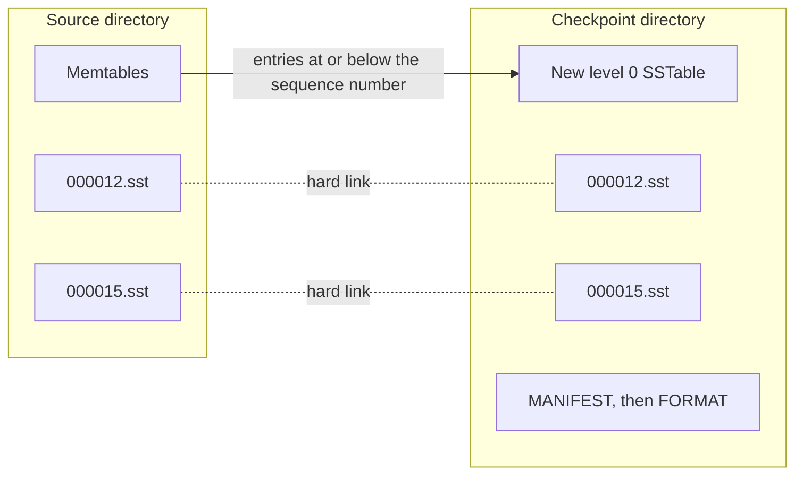

# Checkpoints

A checkpoint gives you a consistent copy of a live database in a new directory, while writes continue. Use it for a backup, or to send a copy of the data to another node. The copy shares the SSTables of the source through hard links, so it is fast: in the Kahuna benchmark, a checkpoint of about 2 GB of values took 0.10 s.

The copy shows every column family as of one sequence number. You can open it as a database.

## Create a checkpoint

```csharp
db.CreateCheckpoint("/backups/data-2026-10-25");
```

The call returns when the copy is complete. The writes to the source continue during the checkpoint.

The rules:

- The directory must not exist. If it exists, or another database or checkpoint holds it, the call throws `ArgumentException`.
- The copy is a database directory. Open it with `SolariumDb.Open`.
- The copy holds no WAL file. It opens with nothing to replay.

## How the copy is made

1. Under a short lock, the checkpoint reads the latest published sequence number. It also keeps the current version of each column family open, so that their SSTables stay on disk.
2. For each memtable of each version, it writes a level 0 SSTable in the copy with the entries at or below that sequence number.
3. It links the SSTables of every level into the copy, with their own numbers and levels. A link is a second name for the same file, so it costs no copy.
4. It writes the `MANIFEST` of the copy, which lists those tables and no WAL file.
5. It writes `FORMAT`, the last file.



An SSTable never changes after the manifest names it, and a delete removes only one name. So the copy and the source share each file safely.

When the file system refuses a link, for example because the copy is on another file system, the checkpoint copies that table and every later one.

## A checkpoint that fails

`Open` refuses a directory that has files but no `FORMAT` file. `FORMAT` is written last, so a copy that a crash or a failure cut short never opens as a database.

After a failure, the call deletes the files that it wrote. A failure of the copy does not stop the writes to the source.

## Checkpoints and Dispose

`Dispose` on the source stops a checkpoint that has not started to write `FORMAT`. That checkpoint fails with `ObjectDisposedException` and deletes what it wrote. A checkpoint that has started to write `FORMAT` completes before `Dispose` returns.

## Cost

A checkpoint writes only the memtables. Everything else is a hard link. In the Kahuna benchmark, a checkpoint of the `large` dataset (2,000,000 keys, about 2 GB of values) took 0.10 s and wrote 7 MiB. RocksDB took 0.03 s.

On a different file system, the checkpoint copies every table, and its time grows with the size of the store.

A checkpoint differs from one in RocksDB in three ways: it holds no WAL file, it never flushes the source, and `Dispose` stops it safely. See [Differences from RocksDB](../reference/rocksdb-differences.md#checkpoints).
