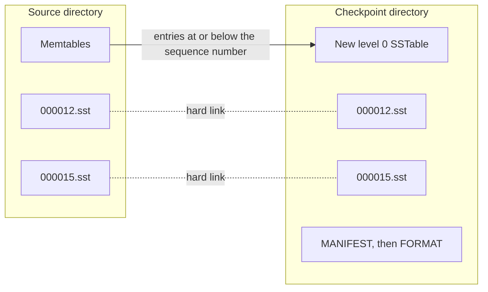

# Checkpoints

A checkpoint gives you a consistent copy of a live database in a new directory, while writes continue. Use it for a backup, or to send a copy of the data to another node. The copy is fast, as it shares the SSTables of the source through hard links. In the Kahuna benchmark, a checkpoint of about 2 GB of values took 0.04 s.

The copy shows all column families as of one sequence number. You can open it as a database.

## Create a checkpoint

```csharp
db.CreateCheckpoint("/backups/data-2026-10-25");
```

The call returns when the copy is complete. Writes to the source continue during the checkpoint.

The target directory must be new, and the copy is a normal database directory.

- The call throws `ArgumentException` if the directory exists, or if another open database or checkpoint uses it.
- Open the copy with `SolariumDb.Open`.
- The copy does not contain a WAL file. This means that there is no replay when you open it.

## How the copy is made

1. Under a short lock, the checkpoint reads the latest published sequence number. It also takes a reference to the current version of each column family. This reference prevents the deletion of their SSTables.
2. For each memtable of each version, it writes a level 0 SSTable in the copy with the entries at or below that sequence number.
3. It links the SSTables of all levels into the copy, with the same numbers and levels. A link is a second name for the same file, and no data is copied.
4. It writes the `MANIFEST` of the copy, which lists those tables and no WAL file.
5. It writes `FORMAT`, the last file.



An SSTable does not change after the manifest names it, and a delete removes only one name. This means that the copy and the source can share each file safely.

Some file systems do not allow the link, for example when the copy is on another file system. In that case, the checkpoint copies that table and all later tables.

## A checkpoint that fails

`FORMAT` is the last file that a checkpoint writes. A directory that has files but no `FORMAT` file cannot be opened. This means that you cannot open a copy that a crash or a failure cut short.

After a failure, the call deletes the files that it wrote. A failure of the copy does not stop the writes to the source.

## Checkpoints and Dispose

`Dispose` on the source stops a checkpoint that has not started to write `FORMAT`. That checkpoint throws `ObjectDisposedException` and deletes what it wrote. A checkpoint that has started to write `FORMAT` completes before `Dispose` returns.

## Cost

A checkpoint writes only the memtables. Everything else is a hard link. In the Kahuna benchmark, a checkpoint of the `large` dataset (2,000,000 keys, about 2 GB of values) took 0.04 s. RocksDB took 0.03 s with the defaults of Kahuna, and 0.04 s with direct reads off. See [Benchmarks](../operations/benchmarks.md#the-persistence-backend-of-kahuna-against-rocksdb).

On a different file system, the checkpoint copies all the tables, and its time grows with the size of the store.

A checkpoint differs from one in RocksDB in three ways. It does not include a WAL file, it does not flush the source, and `Dispose` stops it safely. For more information, see [Differences from RocksDB](../reference/rocksdb-differences.md#checkpoints).
