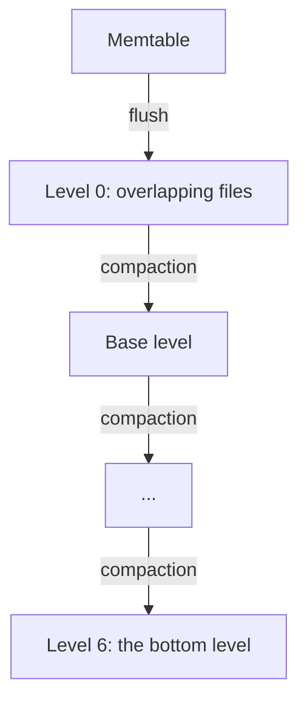

# Flushes and Compaction

Solarium flushes and compacts on its own background threads. You do not need to call anything for a healthy database. This guide explains what the background work does, what you can control, and when to start it yourself.

## Flushes

A **flush** writes a memtable to a new level 0 SSTable.

1. When the active memtable reaches `WriteBufferSize`, it becomes immutable at the next write group. A new active memtable takes the writes.
2. A background thread writes the oldest immutable memtable to an SSTable.
3. The manifest records the new SSTable. The WAL files that no memtable needs any more are deleted.

A column family holds at most `MaxWriteBufferNumber` memtables: the active one and the immutable ones. At this count, writes wait for a flush.

To flush now:

```csharp
db.Flush(log);               // waits until the data is durable in an SSTable
db.Flush(log, wait: false);  // returns at once
```

`Flush` makes the active memtable immutable at once. With `wait: true`, the default, it returns when that data is in an SSTable. The current WAL file changes at the next write group, not at once.

## Compaction

A **compaction** merges SSTables into a lower level. A column family has seven levels:

- **Level 0** holds the flushed memtables. Its files can overlap, and the newest comes first.
- **Levels 1 to 6** hold sorted files. In each level, the files are in key order and share no key.

For each key, every version in a level is newer than every version in the levels below it.



The levels are sized dynamically, as with `level_compaction_dynamic_level_bytes` in RocksDB:

- Level 6, the bottom level, holds what it holds.
- Each level above it has a target of one tenth (`MaxBytesForLevelMultiplier`) of the level below.
- Level 0 compacts into the **base level**: the highest level whose target is still at most `MaxBytesForLevelBase` (256 MB).

So a column family smaller than 256 MB keeps all its sorted data in level 6, and level 0 compacts directly into it.

One background thread runs one compaction at a time, across all column families. It chooses the level with the highest score of at least 1:

- The score of level 0 is its file count divided by `Level0FileNumCompactionTrigger` (4).
- The score of each sorted level above level 6 is its size divided by its target.

### Trivial moves

A file that overlaps nothing in the level below moves down as it is, with one manifest save and no rewrite. This is how an append-only key space, such as a Raft log, reaches level 6 with no compaction writes.

## Manual compaction

```csharp
db.CompactRange(null, null, family);  // the whole column family
```

`CompactRange` compacts a key range down to the bottom level. It does not flush the memtable first. See [Range Deletes](range-deletes.md#compactrange).

## Turn off automatic compaction

```csharp
new ColumnFamilyOptions { DisableAutoCompactions = true }
```

With `DisableAutoCompactions`, no compaction starts on its own for that column family. `CompactRange` still works. Its level 0 file count does not slow or stop writes, because no compaction would end the stall. The memtable count still stops writes when the column family holds `MaxWriteBufferNumber` memtables.

Use this for a bulk load that you compact once at the end.

## Compression

```csharp
new ColumnFamilyOptions { Compression = CompressionType.Lz4 }
```

`Compression` sets how flushes and compactions store the data blocks of new SSTables. The default is `None`. The only codec is `Lz4`. A block that LZ4 makes smaller by less than one eighth is stored raw.

Old SSTables keep their own compression, so you can change the option between opens. There is no block cache, so each read of a compressed block decompresses it. In the Kahuna benchmarks, LZ4 made the store 40% smaller and loads faster, with no measured cost on reads.

## What you can watch

| Property | Meaning |
| --- | --- |
| `rocksdb.num-files-at-level0` to `rocksdb.num-files-at-level6` | The SSTables in each level. |
| `rocksdb.base-level` | The level that level 0 compacts into. |
| `rocksdb.compaction-pending` | 1 when a level needs a compaction. |
| `rocksdb.mem-table-flush-pending` | 1 when a memtable waits for a flush that has not started. |
| `rocksdb.num-running-flushes`, `rocksdb.num-running-compactions` | 0 or 1. There is one thread of each. |

[Diagnostics](../operations/diagnostics.md) explains how to read them.

## Failures

A flush or compaction failure stops all later writes until you open the database again. Reads continue. A crash during a compaction leaves orphan files, and the next open deletes them.
