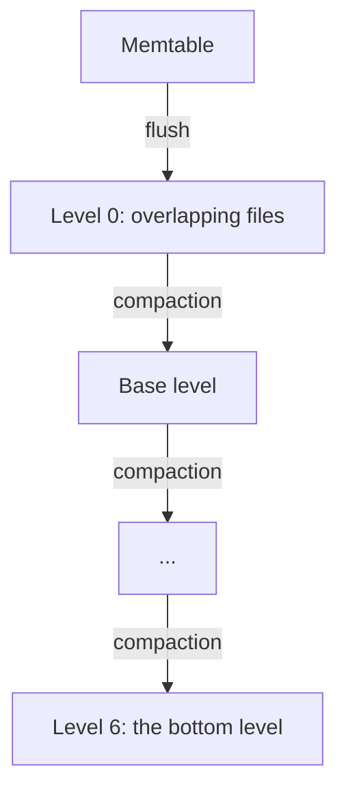

# Flushes and Compaction

Solarium flushes and compacts on its own background threads. You do not need to call anything for a healthy database. This guide explains what the background work does, what you can control, and when to start it yourself.

## Flushes

A **flush** writes a memtable to a new level 0 SSTable.

1. When the active memtable reaches `WriteBufferSize`, it becomes immutable at the next write group. A new active memtable takes the writes.
2. A background thread writes the oldest immutable memtable to an SSTable.
3. The manifest records the new SSTable. The WAL files that no memtable needs any more are deleted.

A column family holds at most `MaxWriteBufferNumber` memtables: the active one and the immutable ones. At this count, writes wait for a flush.

To flush now:

```csharp
db.Flush(log);               // waits until the data is durable in an SSTable
db.Flush(log, wait: false);  // returns at once
```

`Flush` makes the active memtable immutable at once. With `wait: true`, the default, it returns when that data is in an SSTable. The current WAL file changes at the next write group, not at once.

## Compaction

A **compaction** merges SSTables into a lower level. A column family has seven levels:

- **Level 0** holds the flushed memtables. Its files can overlap, and the newest comes first.
- **Levels 1 to 6** hold sorted files. In each level, the files are in key order and share no key.

For each key, every version in a level is newer than every version in the levels below it.



The levels are sized dynamically, as with `level_compaction_dynamic_level_bytes` in RocksDB:

- Level 6, the bottom level, holds what it holds.
- Each level above it has a target of one tenth (`MaxBytesForLevelMultiplier`) of the level below.
- Level 0 compacts into the **base level**: the highest level whose target is still at most `MaxBytesForLevelBase` (256 MB).

So a column family smaller than 256 MB keeps all its sorted data in level 6, and level 0 compacts directly into it.

Up to `MaxBackgroundCompactions` compactions run at once, across all column families, each on its own thread. The default is 1. Each compaction thread takes the level with the highest score of at least 1:

- The score of level 0 is its file count divided by `Level0FileNumCompactionTrigger` (4).
- The score of each sorted level above level 6 is its size divided by its target.

### Trivial moves

A file that overlaps nothing in the level below moves down as it is, with one manifest save and no rewrite. This is how an append-only key space, such as a Raft log, reaches level 6 with no compaction writes.

## Run several compactions at once

When writes stall because level 0 grows faster than one compaction can empty it, let more compactions run at the same time:

```csharp
using SolariumDb db = SolariumDb.Open("./data", new DbOptions { MaxBackgroundCompactions = 4 });
```

Two compactions never read the same file, never compact level 0 of one column family at the same time, and never write overlapping files into one level. So, for each key, the versions in a level stay newer than those in the levels below, as with one thread.

More threads have a cost. In the compaction benchmark with random keys, 6 threads wrote 1.8 times the rows per second of RocksDB, and writes stalled for 0.5 s. But compaction wrote 4.63 times the bytes of the data. The threads also write at the same time, and on a slow drive they take it from synced writes. On a drive whose synced writes took 4 to 8 ms, 8 threads with no limiter made synced batches slower than one thread did. A [rate limiter](#pace-background-writes) gives the drive back. On a drive whose synced writes took about 1 ms, 8 threads with no limiter were faster than one. See [Benchmarks](../operations/benchmarks.md#concurrent-compactions).

`SolariumWAL`, the Kommander WAL, runs 6 compactions on 16 CPUs by default. `Solarium.Kahuna` keeps one, so that its synced writes stay fast.

## Pace background writes

A synced write waits until the drive has its WAL records. Flushes and compactions write large SSTables to the same drive. On a drive with little bandwidth for synced writes, a burst of table writes makes each synced write wait longer. A **rate limiter** caps the bytes per second that flushes and compactions write, so synced writes keep their share of the drive:

```csharp
RateLimiter limiter = new(50L * 1024 * 1024);  // 50 MiB/s for all flushes and compactions

using SolariumDb db = SolariumDb.Open("./data", new DbOptions
{
    MaxBackgroundCompactions = 8,
    RateLimiter = limiter,
});
```

How it works:

- A flush or a compaction writes its SSTable through a 1 MiB buffer. Before each write of the buffer, it asks the limiter for those bytes. When the budget is spent, it waits.
- The budget refills every 100 ms with the rate times the period. Flushes go before compactions. Every tenth refill serves the compactions first, so they always progress.
- With a limiter, `BytesPerSync` is 1 MiB by default. After each 1 MiB, the writer starts the writeback of what it wrote (`sync_file_range` on Linux) and does not wait for it. So the table reaches the drive while it is written, not all at its last sync. `BytesPerSync` makes nothing durable. You can also set it without a limiter.
- The WAL, the manifest, checkpoints, and the flushes of the WAL replay at open are not paced.
- One limiter can pace several databases on one drive. Pass the same instance to each `DbOptions`. `SetBytesPerSecond` changes the rate while the databases run.

The limiter paces flushes too. So choose a rate between two limits:

- **Above what the store ingests.** Flushes must keep up with the writes. Below that rate, each memtable switch waits for a flush, and writes slow down.
- **Below what the drive can write beside the WAL syncs.** Above that rate, the table writes take the drive from synced writes again.

The benchmarks show both sides. On a drive whose synced writes took 4 to 8 ms, the synced batches wrote 11,000 to 13,000 rows per second. There, a limiter of 50 MiB/s brought 8 compaction threads back to the rate of one thread, and made the synced batches of 64 rows of Kahuna 2.5 to 3 times as fast. On the same drive at about 1 ms for each synced write, the batches wrote 50 to 65 MB/s. A limiter of 25 or 50 MiB/s was then below the ingest: every memtable switch waited for a flush, and the batches slowed to 0.2 to 0.4 times their rate with no limiter. See [Paced background writes](../operations/benchmarks.md#paced-background-writes).

The costs:

- **The work moves to after the burst.** The merges that a load leaves behind run after it, at the rate of the limiter.
- **The rate depends on the drive and on the ingest.** Measure both before you choose. Too low a rate makes flushes fall behind, and lets level 0 grow until writes stall.
- **Auto-tuning does not protect synced writes.** `new RateLimiter(rate, autoTuned: true)` starts at half its rate and moves between a twentieth of it and all of it. When no write waits, it drops to the bottom, and it climbs back by 5% every 10 seconds. In the benchmark, it fell to about 3 MiB/s, level 0 passed the slowdown trigger, and synced writes waited for the stall. That run came before a fix to how the limiter counts the time that writes waited, and was not measured again. Use auto-tuning only with a high rate, to smooth bursts.

`Solarium.Kahuna` sets a limiter only when you give it a rate with `--storage-compaction-rate-mbps`. See [Solarium.Kahuna](../integrations/kahuna.md#pace-the-compactions).

## Manual compaction

```csharp
db.CompactRange(null, null, family);  // the whole column family
```

`CompactRange` compacts a key range down to the bottom level. It does not flush the memtable first. It runs alone: while it runs, no automatic compaction starts. See [Range Deletes](range-deletes.md#compactrange).

## Turn off automatic compaction

```csharp
new ColumnFamilyOptions { DisableAutoCompactions = true }
```

With `DisableAutoCompactions`, no compaction starts on its own for that column family. `CompactRange` still works. Its level 0 file count does not slow or stop writes, because no compaction would end the stall. The memtable count still stops writes when the column family holds `MaxWriteBufferNumber` memtables.

Use this for a bulk load that you compact once at the end.

## Compression

```csharp
new ColumnFamilyOptions { Compression = CompressionType.Lz4 }
```

`Compression` sets how flushes and compactions store the data blocks of new SSTables. The default is `None`. The only codec is `Lz4`. A block that LZ4 makes smaller by less than one eighth is stored raw.

Old SSTables keep their own compression, so you can change the option between opens. Without `CacheDataBlocks`, data blocks are not cached in the process, so each read of a compressed block decompresses it. In the Kahuna benchmarks, LZ4 made the store 40% smaller and loads faster, with no measured cost on reads.

## What you can watch

| Property | Meaning |
| --- | --- |
| `rocksdb.num-files-at-level0` to `rocksdb.num-files-at-level6` | The SSTables in each level. |
| `rocksdb.base-level` | The level that level 0 compacts into. |
| `rocksdb.compaction-pending` | 1 when a level needs a compaction. |
| `rocksdb.mem-table-flush-pending` | 1 when a memtable waits for a flush that has not started. |
| `rocksdb.num-running-flushes` | 0 or 1. There is one flush thread. |
| `rocksdb.num-running-compactions` | From 0 to `MaxBackgroundCompactions`. |

A `RateLimiter` also counts what it paced: `TotalBytesThrough`, `TotalRequests`, and `TotalWait`, the time that writes waited for their bytes.

[Diagnostics](../operations/diagnostics.md) explains how to read them.

## Failures

A flush or compaction failure stops all later writes until you open the database again. A failed writeback of `BytesPerSync` fails the flush or the compaction, as a failed write does. Reads continue. A crash during a compaction leaves orphan files, and the next open deletes them.
