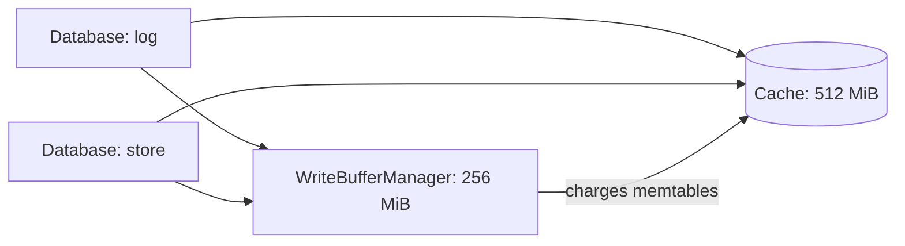

# Block Cache and Memtable Budget

A Solarium database uses memory in two places. The memtables hold the newest writes. The open SSTables keep their index and Bloom filter, about 2% of the table bytes, and 4% with LZ4. Without limits, the first grows with each column family, and the second grows with the data on disk.

Two objects put a bound on both, as in RocksDB. A `Cache` holds the index and filter blocks of the SSTables, and evicts the least recently used. A `WriteBufferManager` caps the memtables of every database that shares it. One process can share both across databases, for example the Raft log and the store of a Kahuna node.

## Quick example

```csharp
using Solarium;

Cache cache = new(capacity: 512L * 1024 * 1024);
WriteBufferManager memtables = new(bufferSize: 256L * 1024 * 1024, cache);

ColumnFamilyOptions tables = new()
{
    BlockCache = cache,
    CacheIndexAndFilterBlocks = true,
    PinL0FilterAndIndexBlocksInCache = true,
};

DbOptions options = new() { DefaultColumnFamilyOptions = tables, WriteBufferManager = memtables };

using SolariumDb log = SolariumDb.Open("./log", options);
using SolariumDb store = SolariumDb.Open("./store", options);
```

Both databases put their index and filter blocks in one 512 MiB cache. Their memtables share one 256 MiB budget. The manager also charges the memtables to the cache, so 512 MiB bounds both together.



The host owns the cache and the manager. Neither holds a resource to dispose.

## The block cache

`ColumnFamilyOptions.BlockCache` names the cache of a column family. `CacheIndexAndFilterBlocks` puts the index and filter of each SSTable in it, instead of in the memory of the table for as long as the table is open. Several column families and databases can share one cache.

### What it holds

The cache holds **index and filter blocks only**. Data blocks are never cached: the page cache of the operating system serves them. Reads measured no gain from a cache of data blocks. What the cache bounds is the memory of the open tables.

Each SSTable cuts its index into **partitions** of about 4 KB of index entries, each with its own Bloom filter, under a small top-level index. One partition and its filter are one cache entry:

1. A table puts every partition in the cache when it opens. It keeps only its top-level index, about 0.04% of its bytes.
2. A lookup searches the top-level index, takes its partition from the cache, checks the filter, and searches the partition for the data block.
3. After an eviction, the next lookup reads that partition again from the file and caches it. That is a few kilobytes.

A table that closes takes its entries out of the cache. So a shared cache holds only open tables.

### Pin level 0

Every lookup searches every level 0 table. `PinL0FilterAndIndexBlocksInCache` pins their partitions, so the cache never evicts them. A table that a compaction moves out of level 0 unpins them.

### Size the cache

Size the cache to hold every index and filter: about 2% of the table bytes, 4% with LZ4, plus the memtable budget when a manager charges it.

| Cache | `Get`, 1 thread | `Get`, 16 threads |
| --- | --- | --- |
| Holds every partition | 2% to 5% slower than without a cache | Up to 7% slower |
| Holds a quarter of the partitions | About 2.5 times slower than a cache that holds them all | 11 to 20 times slower, mostly garbage collection of the partitions that the misses decode |

These are scratch measurements on stores of the Kahuna shapes, read from tmpfs on an i7-13620H. See [Index and filter blocks in a cache](../operations/benchmarks.md#index-and-filter-blocks-in-a-cache).

The capacity is soft, as the default of RocksDB. When only pinned entries are left, the cache stays over its capacity instead of failing a read.

### Reads that do not fill the cache

A scan of rows that you will not read again can evict the partitions that other reads need. Set `ReadOptions.FillCache` to false for it:

```csharp
ReadOptions scan = new() { FillCache = false };
long rows = 0;

using Iterator iterator = log.NewIterator(options: scan);
for (iterator.SeekToFirst(); iterator.Valid(); iterator.Next())
    rows++;
```

A partition that the read finds in the cache is still used. A partition that the cache evicted is read for this read, and not cached again. Compactions always read with `FillCache` off.

## The memtable budget

A `WriteBufferManager` caps the memtables of every database that shares it. Before each write group, the database checks the manager. It flushes when either is true:

- the active memtables of all the databases hold more than 7/8 of the cap;
- all the memtables reach the cap, and the active ones hold half of it.

Then the writing database switches its own column family with the oldest data, and the flush thread writes it to an SSTable. A database never flushes the memtables of another database. So the memtables of a database that takes no writes stay in memory until it writes again.

The manager never stalls writes. Going over the cap only makes the writing database flush.

For one database alone, set `DbOptions.DbWriteBufferSize`. It is a manager of that cap that no other database shares. A `WriteBufferManager` overrides it.

### One capacity for both

`new WriteBufferManager(bufferSize, cache)` also charges the memtables to the cache, in pinned entries of 256 KiB. The index and filter blocks then make room for the memtables. One capacity bounds the memory of both.

## Watch the memory

| Signal | Meaning |
| --- | --- |
| `rocksdb.block-cache-capacity` | The capacity of the cache of the column family. |
| `rocksdb.block-cache-usage` | The bytes in that cache, for everything that shares it, pinned entries included. |
| `rocksdb.block-cache-pinned-usage` | The bytes that cannot be evicted: level 0 partitions and memtable charges. |
| `rocksdb.estimate-table-readers-mem` | With `CacheIndexAndFilterBlocks`, only the range tombstones of the open tables. |
| `WriteBufferManager.MemoryUsage` | The memtables of every database that shares the manager. |
| `WriteBufferManager.MutableMemoryUsage` | The part of it in active memtables. |

`Cache.SetCapacity` and `WriteBufferManager.SetBufferSize` change the limits while the databases run.

## Important considerations

- **A cache lookup takes a lock.** Each lookup takes the lock of one shard of the cache. Without a cache, a read takes no lock. This is part of the cost in the table above.
- **`CacheIndexAndFilterBlocks` needs a `BlockCache`.** Without one, `Open` throws `ArgumentException`. RocksDB gives such a table an 8 MB cache of its own.
- **Old tables have one partition.** A table written before partitions, by an older version of Solarium, keeps one whole index and filter until a compaction rewrites it. A miss on it reads all of it, about 1 MB for a 64 MB table.
- **A reader keeps what it took.** A read keeps the partition that it took after an eviction, until it is done. An iterator keeps the partition of each table that it reads, until it moves to another partition or you dispose it.
- **The manager counts data, not allocations.** It counts the memtables as `rocksdb.cur-size-all-mem-tables` does. A memtable leaves the budget when its flush installs its table, even while an older reader still holds it.

## Related topics

- [Tuning](../operations/tuning.md#memory)
- [Read Path](../architecture/read-path.md)
- [SSTables](../architecture/sstables.md)
- [Options](../reference/options.md)
- [Differences from RocksDB](../reference/rocksdb-differences.md#compression-and-caching)
