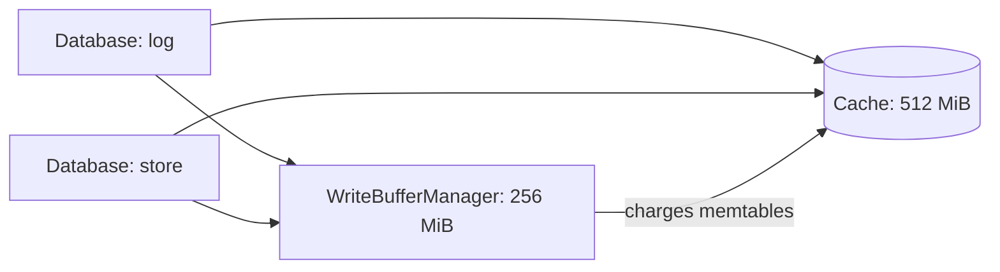

# Block Cache and Memtable Budget

A Solarium database uses memory in two places. The memtables contain the newest writes. The open SSTables need their index and Bloom filter in memory: about 2% of the table bytes, and 4% with LZ4. If you set no limits, the first grows with each column family, and the second grows with the data on disk.

Two objects put a bound on both, as in RocksDB. A `Cache` stores the index and filter blocks of the SSTables, and the data blocks if you ask. It evicts the least recently used. A `WriteBufferManager` caps the memtables of every database that shares it. One process can share both across databases, for example the Raft log and the store of a Kahuna node.

## Quick example

```csharp
using Solarium;

Cache cache = new(capacity: 512L * 1024 * 1024);
WriteBufferManager memtables = new(bufferSize: 256L * 1024 * 1024, cache);

ColumnFamilyOptions tables = new()
{
    BlockCache = cache,
    CacheIndexAndFilterBlocks = true,
    PinL0FilterAndIndexBlocksInCache = true,
};

DbOptions options = new() { DefaultColumnFamilyOptions = tables, WriteBufferManager = memtables };

using SolariumDb log = SolariumDb.Open("./log", options);
using SolariumDb store = SolariumDb.Open("./store", options);
```

Both databases put their index and filter blocks in one 512 MiB cache. Their memtables share one 256 MiB budget. The manager also charges the memtables to the cache. This means that 512 MiB bounds both together.



The host owns the cache and the manager. You do not need to dispose them.

## The block cache

`ColumnFamilyOptions.BlockCache` names the cache of a column family. By default, the index and filter of an SSTable are in the memory of the table for as long as the table is open. `CacheIndexAndFilterBlocks` puts them in the cache. Several column families and databases can share one cache.

### What it holds

By default, only **index and filter blocks** are in the cache. What it bounds is the memory of the open tables. The page cache of the operating system serves the data blocks. To cache the data blocks too, see [Cache data blocks](#cache-data-blocks).

Each SSTable cuts its index into **partitions** of about 4 KB of index entries. Each partition has its own Bloom filter, and a small top-level index covers all the partitions. One partition and its filter are one cache entry.

1. A table puts all its partitions in the cache when it opens. Only its top-level index remains in the memory of the table, about 0.04% of its bytes.
2. A lookup searches the top-level index and takes its partition from the cache. It checks the filter, and then searches the partition for the data block.
3. After an eviction, the next lookup reads that partition again from the file and caches it. That is a few kilobytes.

A table that closes takes its entries out of the cache. This means that a shared cache contains only the entries of open tables.

### Pin level 0

A lookup searches all the level 0 tables. `PinL0FilterAndIndexBlocksInCache` pins their partitions, and the cache does not evict them. A table that a compaction moves out of level 0 unpins them.

### Size the cache

The cache should be large enough for all the index and filter blocks: about 2% of the table bytes, 4% with LZ4. Add the memtable budget when a manager charges it.

| Partitions that fit in the cache | `Get`, 1 thread | `Get`, 16 threads |
| --- | --- | --- |
| All | 2% to 5% slower than without a cache | Up to 7% slower |
| A quarter | About 2.5 times slower than with a cache for all of them | 11 to 20 times slower, mostly garbage collection of the partitions that the misses decode |

These are scratch measurements on stores of the Kahuna shapes, read from tmpfs on an i7-13620H. See [Index and filter blocks in a cache](../operations/benchmarks.md#index-and-filter-blocks-in-a-cache).

The capacity is soft, as the default of RocksDB. When only pinned entries are left, the cache can go over its capacity. A read does not fail for this reason.

### Cache data blocks {#cache-data-blocks}

With `CacheDataBlocks`, the data blocks that reads take are stored in the cache, verified and decompressed. A read of a cached block does not read the file. It also skips the checksum and the decompression.

```csharp
ColumnFamilyOptions tables = new()
{
    BlockCache = cache,
    CacheIndexAndFilterBlocks = true,
    CacheDataBlocks = true,
};
```

- Point reads (`Get` and `MultiGet`) and iterators look up their data blocks in the cache. A block that `MultiGet` finds in the cache does not join its batch read.
- A miss reads the block from the file and caches it, unless `ReadOptions.FillCache` is false.
- Compactions never fill the cache. Their inputs do not push out the blocks of the readers.

A cached data block is in native memory, outside the managed heap. A read has a reference to the block until it is done with it. An eviction frees the block after its last reader.

RocksDB caches data blocks whenever it has a block cache. In Solarium, `CacheDataBlocks` is off by default, because it paid only on a store that fits in the cache. The table compares the Kahuna benchmark with `CacheDataBlocks` on and off, on the same code.

| Workload | Reads with `CacheDataBlocks` |
| --- | --- |
| A store that fits in the cache, from 1 or 8 threads | 1.14 to 1.46 times as many gets |
| Misses from 8 threads, a store that fits in the cache | 0.75 times as many |
| A store about ten times the cache | 0.65 to 0.93 times as many |

On a large store, most reads miss. Each miss copies its block into the cache and evicts another, under the lock of a shard. Turn it on when the data that your reads use fits in the cache. Measure it on your own workload. See [Data blocks in a cache](../operations/benchmarks.md#data-blocks-in-a-cache).

### The high-priority pool

As in the LRU cache of RocksDB, each shard of the cache has two pools.

- The **high-priority pool** is for the index and filter partitions, and each entry read again after its insert. Its size is up to `HighPriorityPoolRatio` of the shard, 0.5 by default.
- The **low-priority pool** is for the other entries, for example data blocks read once.

An eviction takes from the low-priority pool first. This means that the blocks of a long scan push out one another first. The indexes and the blocks that reads use often remain in the high-priority pool. `CacheIndexAndFilterBlocksWithHighPriority`, true by default, puts the partitions in the high-priority pool. If you want a single LRU list, create the cache with `new Cache(capacity, highPriorityPoolRatio: 0)`.

### Reads that do not fill the cache

A scan of rows that you will not read again can evict the blocks that other reads need. Set `ReadOptions.FillCache` to false for such a scan.

```csharp
ReadOptions scan = new() { FillCache = false };
long rows = 0;

using Iterator iterator = log.NewIterator(options: scan);
for (iterator.SeekToFirst(); iterator.Valid(); iterator.Next())
    rows++;
```

If the read finds a block in the cache, it uses that block. A block that is not in the cache is read for this read only, and not cached. Compactions always read with `FillCache` off.

## The memtable budget

A `WriteBufferManager` caps the memtables of every database that shares it. Before each write group, the database checks the manager. It flushes when at least one of two conditions is true.

- The active memtables of all the databases use more than 7/8 of the cap.
- All the memtables reach the cap, and the active ones use half of it.

Then the writing database switches its column family with the oldest data, and the flush thread writes it to an SSTable. A database does not flush the memtables of another database. If a database takes no writes, its memtables remain in memory until it writes again.

The manager does not stall writes. Going over the cap only makes the writing database flush.

For one database alone, set `DbOptions.DbWriteBufferSize`. It is a manager of that cap that no other database shares. A `WriteBufferManager` overrides it.

### One capacity for both

`new WriteBufferManager(bufferSize, cache)` also charges the memtables to the cache, in pinned entries of 256 KiB. The index and filter blocks then make room for the memtables. One capacity bounds the memory of both.

## Watch the memory

| Signal | Meaning |
| --- | --- |
| `rocksdb.block-cache-capacity` | The capacity of the cache of the column family. |
| `rocksdb.block-cache-usage` | The bytes in that cache, for everything that shares it, pinned entries included. |
| `rocksdb.block-cache-pinned-usage` | The bytes that cannot be evicted: level 0 partitions and memtable charges. |
| `rocksdb.estimate-table-readers-mem` | With `CacheIndexAndFilterBlocks`, only the range tombstones of the open tables. |
| `WriteBufferManager.MemoryUsage` | The memtables of all the databases that share the manager. |
| `WriteBufferManager.MutableMemoryUsage` | The part of it in active memtables. |

The memtables and the cached data blocks are native memory. The .NET memory tools and the heap limit of the GC do not see them. These signals do. The index and filter partitions in the cache are on the managed heap.

The memtables of a database can use a little more native memory than their size: at most one partly used chunk of 64 KiB for each processor that wrote to a memtable. The chunks of a flushed memtable go back to a pool for the next memtables, within the memtable budget.

`Cache.SetCapacity` and `WriteBufferManager.SetBufferSize` change the limits while the databases run.

## Important considerations

- **A cache lookup takes a lock.** Each lookup takes the lock of one shard of the cache. Without a cache, a read takes no lock. This is part of the cost in the table above.
- **`CacheIndexAndFilterBlocks` and `CacheDataBlocks` need a `BlockCache`.** If you do not set one, `Open` throws `ArgumentException`. RocksDB creates a cache for such a table, 32 MiB in current releases.
- **Retired tables leave their data blocks.** When a compaction retires a table, its index and filter partitions leave the cache at once. Its data blocks stay until the cache evicts them, as in RocksDB. A database that closes erases all its entries from the cache.
- **Old tables have one partition.** A table written before partitions, by an older version of Solarium, has one undivided index and filter until a compaction rewrites it. A miss on it reads all of it, about 1 MB for a 64 MB table.
- **An eviction does not free what a reader uses.** A read can use the partition that it took until it is done. An iterator uses the partition of each table that it reads, until it moves to another partition or you dispose it.
- **The manager counts the size of the data.** It counts the memtables as `rocksdb.cur-size-all-mem-tables` does. A memtable leaves the budget when its flush installs its table, even if an older reader uses it. Its native memory goes when the last reader releases it.

## Related topics

- [Tuning](../operations/tuning.md#memory)
- [Read Path](../architecture/read-path.md)
- [SSTables](../architecture/sstables.md)
- [Options](../reference/options.md)
- [Differences from RocksDB](../reference/rocksdb-differences.md#compression-and-caching)
