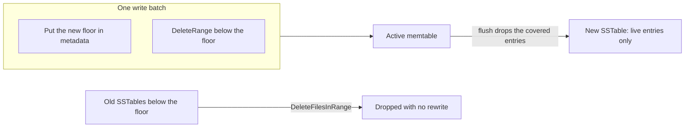

# Range Deletes

A range delete removes every key in a range with one write. A Raft log uses it to drop the dead prefix of the log: millions of old entries go away without one delete for each entry.

Solarium has three ways to remove a range of keys. They differ in cost and in what they guarantee. Kommander combines all three.

| Method | What it writes | When the space comes back | Guarantee |
| --- | --- | --- | --- |
| `DeleteRange` | One range tombstone | At a later compaction | Exact. Reads see no key in the range at once. |
| `DeleteFilesInRange` | One manifest save | At once, for whole files | Drops whole files only. Ignores sequence numbers. |
| `CompactRange` | A rewrite of the range | When the call returns | Exact. Removes what the deletes in the range hide. |

## DeleteRange

```csharp
db.DeleteRange("log:0000"u8, "log:5000"u8);

// The same, inside a batch:
db.Write(new WriteBatch()
    .DeleteRange("log:0000"u8, "log:5000"u8, log)
    .Put("floor"u8, "5000"u8, metadata),
    WriteOptions.Synced);
```

`DeleteRange` deletes every key in `[begin, end)`: the begin key is included and the end key is excluded. It writes one **range tombstone**. A range tombstone is a marker that hides every older version of the keys in its range, in every older source.

- An empty range, where `begin` equals `end`, writes nothing.
- An end key before the begin key throws `ArgumentException` when you add it to the batch.
- A put of a key in the range after the range delete is visible again, because it is newer than the tombstone.

Range tombstones cost reads very little. Each read checks the tombstones that can cover its key, and Solarium indexes them so that the check stays fast with thousands of tombstones. On the benchmark machine (a 13th Gen Intel Core i7-13620H on Linux), a `Get` in a memtable with 8,192 tombstones took 0.23 µs, against 0.20 µs with none. [Memtable](../architecture/memtable.md) explains the index.

## DeleteFilesInRange

```csharp
db.DeleteFilesInRange("log:0000"u8.ToArray(), "log:5000"u8.ToArray(), log);
```

`DeleteFilesInRange` drops, in one manifest save, the SSTables of levels 1 to 6 whose keys all lie in the range. It does not rewrite data. The rules:

- `includeEnd` is true by default, as in the C API of RocksDB. Then the end key is part of the range.
- It does not touch level 0, the memtables, or the files of a compaction that runs.
- It ignores sequence numbers, as in RocksDB. A key of a dropped file is gone for later reads, even when no delete was written for it.
- Reads and iterators that started before the call still see the dropped files.
- An older version of a key, in a lower file that reaches past the range, can come back. A store whose keys are written once, as a Raft log, has no such version.

Use `DeleteFilesInRange` together with `DeleteRange`: the tombstone makes the delete exact, and the file drop gives back the space at once.

## CompactRange

```csharp
db.Flush(log);
db.CompactRange("log:0000"u8.ToArray(), "log:5000"u8.ToArray(), log);
```

`CompactRange` compacts the range one level after the other, as the manual compaction of RocksDB does. A delete in the range reaches the bottom level and drops what it hides. Pass null for an open end.

- It returns when the last compaction is installed.
- It does not flush a memtable that overlaps the range first. Call `Flush` first if the memtable holds data in the range.
- It does not rewrite level 6 files alone. Only files that a level above overlaps are rewritten.

`CompactRange` can write a lot of data. Use it for maintenance, not on every write.

## The Raft log pattern

Kommander removes the dead prefix of a partition log this way:



1. Write the new compaction floor to the metadata and a range tombstone below the floor, in one batch.
2. The tombstone stays in the active memtable. When that memtable flushes, the flush drops the log rows that the tombstone covers, so they never reach an SSTable.
3. Call `DeleteFilesInRange` below the floor. The SSTables whose last entry is below the floor go away with no rewrite.

This works well because the files of one partition do not overlap: each file holds log ids that are all higher than those of the files before it. So compaction moves them down whole, and the file drop removes them whole. In the compaction benchmark, this pattern wrote zero bytes in compactions.
