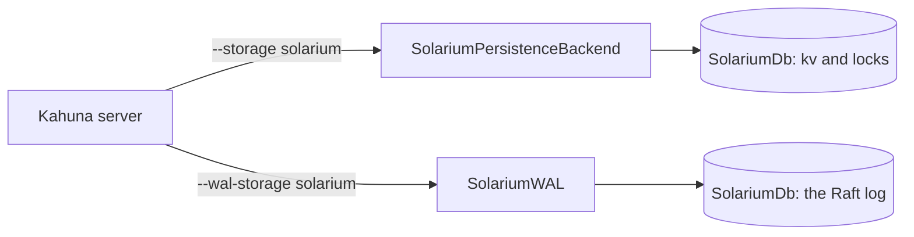
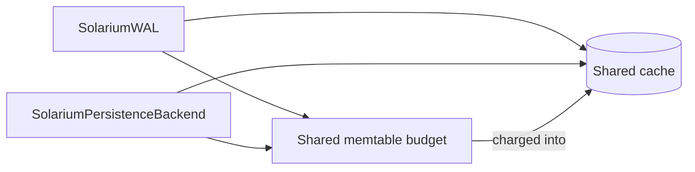

# Solarium.Kahuna

`Solarium.Kahuna` is a [Kahuna](https://kahunakv.github.io/) storage engine on Solarium. It holds both things that a Kahuna node stores, so a node runs with no native RocksDB library:

| Kahuna option | Provider | Stores |
| --- | --- | --- |
| `--storage solarium` | `SolariumPersistenceBackendProvider` | The key-value and lock data, through `SolariumPersistenceBackend`. |
| `--wal-storage solarium` | `SolariumWalProvider` | The Raft log, through `SolariumWAL` from [Solarium.Kommander](kommander.md). |



The package is `SolariumDb.Kahuna`. Its assembly and its namespace are `Solarium.Kahuna`.

It needs Kahuna 1.14.4 or later:

- 1.13.4 brought the public storage contract: `IPersistenceBackend` with immutable rows, and the `StorageProviders` registry of `IPersistenceBackendProvider` and `IWalProvider`.
- 1.14.1 brought the storage settings that pace the compactions.
- 1.14.2 brought the memory that the WAL and the store share.
- 1.14.4 brought the `--extension-option` settings, and the `System.IO.Hashing` version that Solarium uses.

## Load it into a Kahuna server

The Kahuna server loads the package as an **extension assembly**. Publish the package, then point the server at the published assembly:

```shell
dotnet publish src/Solarium.Kahuna -c Release -o /opt/kahuna/solarium

kahuna-server --extension-assembly /opt/kahuna/solarium/Solarium.Kahuna.dll \
              --storage solarium --storage-path /var/lib/kahuna/data \
              --wal-storage solarium --wal-path /var/lib/kahuna/wal
```

The published folder holds only what the server does not have: the Solarium assemblies, ioxide (the io_uring runtime), and `K4os.Compression.LZ4` for the LZ4 of the tables. That is about 4 MB. Kahuna.Core, Kommander, and their dependencies are not in it, because the loader of the server always takes its own copy of an assembly that the server has.

Every node of a cluster loads the same artifact. The server logs the SHA-256 of each file and the engines that it registered.

## Choose the storage environment

By default, the WAL and the store use the default [storage environment](../architecture/storage-environments.md), which works on every platform. On Linux, `--extension-option solarium.environment=io_uring` puts both on the [io_uring storage environment](../guides/io-uring.md):

```shell
kahuna-server --extension-assembly /opt/kahuna/solarium/Solarium.Kahuna.dll \
              --storage solarium --wal-storage solarium \
              --extension-option solarium.environment=io_uring
```

| Value | Storage environment |
| --- | --- |
| `default`, or no setting | The default storage environment. |
| `io_uring` | One `IoUringStorageEnvironment` for every Solarium database of the process. It lives as long as the process. It needs Linux with io_uring. |

Choose io_uring when lookups often miss the page cache. Its batched reads (`MultiGet`, which `GetKeyValues` uses) keep those misses in flight together. From the drive, they read 1.6 to 2.4 times as many keys. It costs 3% to 5% on batched reads that hit the page cache. Its writes go through one reactor thread, so they slow down when readers keep every CPU busy. See [Storage Environments](../architecture/storage-environments.md).

The setting changes how the files are read and written, not what they hold. So you can change it between restarts.

A misspelled setting stops the node. A `solarium.` key other than `solarium.environment`, or a value other than `default` and `io_uring`, fails the open with a message that names it. On a machine that cannot create an io_uring ring, `io_uring` fails the open too.

## Pace the compactions

Two storage settings of Kahuna pace the compactions of the store:

| Setting | Effect |
| --- | --- |
| `--storage-compaction-rate-mbps` | Gives the store a `RateLimiter` of that rate for its flush and compaction writes, and runs `max(2, CPUs / 2)` compactions at once, as the RocksDB backend does. |
| `--storage-max-background-compactions` | Sets the number of compactions that run at once. |

With neither, the store runs one compaction at a time and paces nothing.

The limiter paces flushes too. So its rate must stay above what the store ingests, and below what leaves the disk free for the WAL syncs. On a disk whose synced writes took 4 to 8 ms, a rate of 50 made the synced batches of 64 rows 2.5 times as fast as one compaction with no pacing. On the same disk at about 1 ms for each synced write, the synced batches wrote more than 25 and 50 MB/s. The flushes then held them to 0.2 to 0.4 times their rate with no pacing. See [Pace background writes](../guides/flushes-and-compaction.md#pace-background-writes). Too low a rate lets level 0 grow until writes slow down.

## Share memory between the WAL and the store

Two settings give the WAL and the store of a node memory to share. Both providers take the `SharedStorageMemory` of the node, and use the same Solarium objects for it:

| Setting | Effect |
| --- | --- |
| `--storage-shared-cache-mb` | One `Cache` for the index and filter blocks of both, pinned at level 0. It takes the place of the process-wide cache of the store (below), and the WAL, which otherwise keeps its blocks in memory, joins it. Size it to hold every index and filter of both, about 2% of their table bytes and 4% with LZ4, plus the memtable budget. |
| `--storage-shared-memtable-budget-mb` | One `WriteBufferManager` for the memtables of both, as the shared write-buffer manager of the RocksDB pair. Past it, the database that writes next flushes its own oldest memtable, never that of the other. Nothing stalls. With a shared cache, the budget is charged into the cache, so one size bounds both. |

Both are 0 by default. A Solarium WAL beside another store, or a Solarium store beside another WAL, uses them alone.

Size the memtable budget above 256 MiB, two of the 128 MiB shard memtables of the WAL. Below that, the WAL warns at open, because a smaller budget flushes the memtables of the WAL before they fill.

Neither budget is on the managed heap, as with RocksDB. The memtables are in native arenas, and the cached data blocks of `CacheDataBlocks` are native memory. So a node sized for RocksDB needs no larger heap limit for the GC (`DOTNET_GCHeapHardLimit`) on Solarium. What stays on the managed heap is the index and filter partitions in the cache, about 2% of the table bytes and 4% with LZ4. The process holds at most the memtable budget for memtables, plus one partly used chunk of 64 KiB for each processor and memtable.



## Register it in an embedded node

An embedded Kahuna node registers the providers in code:

```csharp
using Solarium.Kahuna;

EmbeddedKahunaOptions options = new() { Storage = "solarium", WalStorage = "solarium", /* paths... */ };
options.StorageProviders.Register(new SolariumPersistenceBackendProvider());
options.StorageProviders.Register(new SolariumWalProvider());
```

An embedded node gives the extension options in `EmbeddedKahunaOptions.ExtensionOptions`. A provider that you construct with an `IStorageEnvironment` uses that one, whatever the settings of the node. `OpenAt` and `MergeCheckpointInto`, which Kahuna calls for backups and restores, use the default storage environment, unless the provider has one from its constructor.

## What it keeps from the RocksDB backend

`SolariumPersistenceBackend` is a port of the `RocksDbPersistenceBackend` of Kahuna. It is not a new design. It keeps:

- the database at `{storage path}/{revision}`, with the column families `kv` and `locks`;
- the rows: the `RocksDbKeyValueMessage` and `RocksDbLockMessage` protobufs of Kahuna, from `Kahuna.Core`;
- the keys: `{key}~CURRENT` for the current row, `{key}~{revision}` for each retained revision, and `{key}~NOREV` for the no-revision provenance;
- the tilde-key registry, the durability floors, and the pruned-history floor with its legacy key;
- revision pruning, with its memo, its sweep, and its quiescence proof;
- the scans, with the snapshot prefix scan and the seek over a deep revision run;
- the recovery from a storage failure: close and reopen in place, behind a swap fence;
- checkpoints: plain, exact as-of, key-filtered, and the merge of the share of one node into another.

## Differences from the RocksDB backend

- **An index and filter cache, not a block cache.** Without `--storage-shared-cache-mb`, the tables of the store keep their index and filter blocks in a 256 MiB cache that every Solarium store of the process shares, pinned at level 0. The RocksDB backend keeps them in its process-wide 256 MiB block cache. The cache holds no data blocks: the backend does not set `CacheDataBlocks`, and the page cache of the operating system serves them. 256 MiB holds the indexes and filters of about 12 GB of tables, or 6 GB with LZ4. Past that, a lookup that misses reads one partition of the index and filter of its table again, a few kilobytes. With a cache of a quarter of them, lookups from one thread ran about 2.5 times slower. Tables written before partitions keep one whole index and filter until a compaction rewrites them, and a miss on one of them reads all of it.
- **No RocksDB tuning.** Direct reads, Bloom filter settings, statistics, and `--rocksdb-shared-memory` do not apply. The shared cache and memtable budget above do. The tables of Solarium have a fixed 10-bit Bloom filter. The `kv` column family keeps a 64 MiB memtable with up to three. The `locks` column family keeps 8 MiB with up to two. These are the sizes of the RocksDB backend.
- **Checkpoints hold no WAL.** A checkpoint is `SolariumDb.CreateCheckpoint`. Its tables are hard links to those of the store, as in RocksDB, or copies when the checkpoint is on another file system. What the memtables hold goes to tables of the copy, so the live store is not flushed. A live checkpoint is staged on the file system of the store, as in the RocksDB backend (`StagesLiveCheckpointsInStore` is true).
- **LZ4, and one compaction thread unless paced.** Both column families compress their tables with LZ4. The RocksDB backend uses Snappy, the default of RocksDB. Solarium compacts into the levels of RocksDB, sized as RocksDB sizes them. Without `--storage-compaction-rate-mbps`, it runs one compaction at a time, where the RocksDB backend runs `max(2, CPUs / 2)`. With no pacing, several compactions take the disk from synced writes and slow them.
- **The trim is not rate limited.** The `RateLimiter` of Solarium paces flush and compaction writes only. `BackupCaptureThrottleBytesPerSec` also counts the reads of the trim (`kAllIo` in RocksDB). So the backend does not apply it to the as-of trim of a checkpoint copy.
- **The purge flushes first.** The `CompactRange` of Solarium does not flush a memtable first. So the trim and the merge flush each column family before they compact it.
- **Batched reads read one column family for each call.** The `MultiGet` of Solarium reads one column family for each call. Every batched read here reads the `kv` column family only.

## Build against Kahuna

`Solarium.Kahuna` references the `Kahuna.Core` package from nuget.org. The loader of the server gives an extension its own copy of every assembly that the server has. So the `Kahuna.Core` of the server must have at least the assembly version that this package was built against. A server older than the referenced `Kahuna.Core` cannot load the extension.

Raise the reference only to a Kahuna release that the servers that load it already run.

## Performance

The [Kahuna benchmarks](../operations/benchmarks.md#the-persistence-backend-of-kahuna-against-rocksdb) compare both backends. In summary:

- With its tables in the page cache, Solarium made 1.05 to 1.8 times the gets and scans of RocksDB through the page cache on the `large` dataset, and 1.4 to 1.95 times on `history`. Misses on the small stores were slower, at 0.68 to 0.99 times.
- Loads and synced batches ran 1.07 to 1.32 times as fast. Synced writes of one row are bound by the drive on every engine.
- With less memory than the store, gets and scans were 1.2 to 1.8 times as fast, but writes were slower on the default storage environment.
- With LZ4, the store is the same size as that of RocksDB. The compactions after a load wrote more bytes than those of RocksDB, so the store took longer to go quiet.
- A plain checkpoint takes about 0.04 s, because it links the tables.

## Tests

`tests/Solarium.Kahuna.Tests` holds the behavior tests of the RocksDB backend of Kahuna, ported to `SolariumPersistenceBackend`:

- the backend tests of `TestPersistenceBackends`;
- revision pruning: memo, sweep quiescence, time budget, and snapshot floor;
- as-of reads: revision at or before, probes, run seeks, prefix scans, batched gets, the monotonic current head, and no-revision writes;
- checkpoints: as-of, the pruned-history floor, key-filtered composition, and merge;
- the recovery from a storage failure.

A recovery test injects a write failure through `HookedEnvironment` on the default and io_uring storage environments. The other ported tests run on the default storage environment, as those of Kahuna do.

From end to end, a Kahuna server loaded the published extension, took writes over REST on `--storage solarium --wal-storage solarium`, and read every key back after a SIGKILL and a restart. The same run on RocksDB gave the same result.
