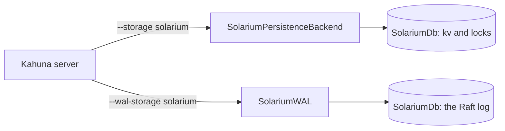

# Solarium.Kahuna

`Solarium.Kahuna` is a [Kahuna](https://kahunakv.github.io/) storage engine on Solarium. It holds both things that a Kahuna node stores, so a node runs with no native RocksDB library:

| Kahuna option | Provider | Stores |
| --- | --- | --- |
| `--storage solarium` | `SolariumPersistenceBackendProvider` | The key-value and lock data, through `SolariumPersistenceBackend`. |
| `--wal-storage solarium` | `SolariumWalProvider` | The Raft log, through `SolariumWAL` from [Solarium.Kommander](kommander.md). |



It needs Kahuna 1.13.4 or later. That is the first release with the public storage contract: `IPersistenceBackend` with immutable rows, and the `StorageProviders` registry of `IPersistenceBackendProvider` and `IWalProvider`.

## Load it into a Kahuna server

The Kahuna server loads the package as an **extension assembly**. Publish the package, then point the server at the published assembly:

```shell
dotnet publish src/Solarium.Kahuna -c Release -o /opt/kahuna/solarium

kahuna-server --extension-assembly /opt/kahuna/solarium/Solarium.Kahuna.dll \
              --storage solarium --storage-path /var/lib/kahuna/data \
              --wal-storage solarium --wal-path /var/lib/kahuna/wal
```

The published folder holds only what the server does not have: the Solarium assemblies and ioxide, the io_uring runtime. That is about 4 MB. Kahuna.Core, Kommander, and their dependencies are not in it, because the loader of the server always takes its own copy of an assembly that the server has.

Every node of a cluster loads the same artifact. The server logs the SHA-256 of each file and the engines that it registered.

## Register it in an embedded node

An embedded Kahuna node registers the providers in code:

```csharp
using Solarium.Kahuna;

EmbeddedKahunaOptions options = new() { Storage = "solarium", WalStorage = "solarium", /* paths... */ };
options.StorageProviders.Register(new SolariumPersistenceBackendProvider());
options.StorageProviders.Register(new SolariumWalProvider());
```

Both providers take an `IStorageEnvironment`. The constructors with no parameters, which the extension loader calls, use the default storage environment.

## What it keeps from the RocksDB backend

`SolariumPersistenceBackend` is a port of the `RocksDbPersistenceBackend` of Kahuna. It is not a new design. It keeps:

- the database at `{storage path}/{revision}`, with the column families `kv` and `locks`;
- the rows: the `RocksDbKeyValueMessage` and `RocksDbLockMessage` protobufs of Kahuna, from `Kahuna.Core`;
- the keys: `{key}~CURRENT` for the current row, `{key}~{revision}` for each retained revision, and `{key}~NOREV` for the no-revision provenance;
- the tilde-key registry, the durability floors, and the pruned-history floor with its legacy key;
- revision pruning, with its memo, its sweep, and its quiescence proof;
- the scans, with the snapshot prefix scan and the seek over a deep revision run;
- the recovery from a storage failure: close and reopen in place, behind a swap fence;
- checkpoints: plain, exact as-of, key-filtered, and the merge of the share of one node into another.

## Differences from the RocksDB backend

- **No RocksDB tuning.** Direct reads, the block cache, Bloom filter settings, statistics, and the shared memory budget (`RocksDbSharedResources`) do not apply. The tables of Solarium have a fixed 10-bit Bloom filter and use the page cache of the operating system. The `kv` column family keeps a 64 MiB memtable with up to three. The `locks` column family keeps 8 MiB with up to two. These are the sizes of the RocksDB backend.
- **Checkpoints hold no WAL.** A checkpoint is `SolariumDb.CreateCheckpoint`. Its tables are hard links to those of the store, as in RocksDB, or copies when the checkpoint is on another file system. What the memtables hold goes to tables of the copy, so the live store is not flushed. A live checkpoint is staged on the file system of the store, as in the RocksDB backend (`StagesLiveCheckpointsInStore` is true).
- **LZ4, and one compaction thread.** Both column families compress their tables with LZ4. The RocksDB backend uses Snappy, the default of RocksDB. Solarium compacts into the levels of RocksDB, sized as RocksDB sizes them, with one compaction at a time. The RocksDB backend runs `max(2, CPUs / 2)`. With more threads, the compactions take the drive from synced writes, and slow them to about a third on a store of gigabytes. A `RateLimiter` with 8 threads beat one thread in every benchmark case except the drain after a load. But its rate depends on the drive, and the configuration of Kahuna has no setting for it.
- **The trim is not rate limited.** The `RateLimiter` of Solarium paces flush and compaction writes only. `BackupCaptureThrottleBytesPerSec` also counts the reads of the trim (`kAllIo` in RocksDB). So the backend does not apply it to the as-of trim of a checkpoint copy.
- **The purge flushes first.** The `CompactRange` of Solarium does not flush a memtable first. So the trim and the merge flush each column family before they compact it.
- **Batched reads read one column family for each call.** The `MultiGet` of Solarium reads one column family for each call. Every batched read here reads the `kv` column family only.

## Build against Kahuna

`Solarium.Kahuna` references the `Kahuna.Core` package from nuget.org. The loader of the server gives an extension its own copy of every assembly that the server has. So the `Kahuna.Core` of the server must have at least the assembly version that this package was built against. A server older than the referenced `Kahuna.Core` cannot load the extension.

Raise the reference only to a Kahuna release that the servers that load it already run.

## Performance

The [Kahuna benchmarks](../operations/benchmarks.md#the-persistence-backend-of-kahuna-against-rocksdb) compare both backends. In summary:

- With its tables in the page cache, Solarium matched or beat RocksDB on gets and scans, with no block cache.
- With LZ4, the store is the same size as that of RocksDB.
- Several compaction threads slow synced writes on a large store, because they take the drive. That is why the backend keeps one compaction thread. With 8 threads and a rate limiter of 50 MiB/s, synced batches of 64 rows ran 2.5 times as fast as with one thread, but the merges took 78 seconds after a load, against 6.
- A plain checkpoint takes about 0.1 s, because it links the tables.

## Tests

`tests/Solarium.Kahuna.Tests` holds the behavior tests of the RocksDB backend of Kahuna, ported to `SolariumPersistenceBackend`:

- the backend tests of `TestPersistenceBackends`;
- revision pruning: memo, sweep quiescence, time budget, and snapshot floor;
- as-of reads: revision at or before, probes, run seeks, prefix scans, batched gets, the monotonic current head, and no-revision writes;
- checkpoints: as-of, the pruned-history floor, key-filtered composition, and merge;
- the recovery from a storage failure.

A recovery test injects a write failure through `HookedEnvironment` on the default and io_uring storage environments. The other ported tests run on the default storage environment, as those of Kahuna do.

From end to end, a Kahuna server loaded the published extension, took writes over REST on `--storage solarium --wal-storage solarium`, and read every key back after a SIGKILL and a restart. The same run on RocksDB gave the same result.
