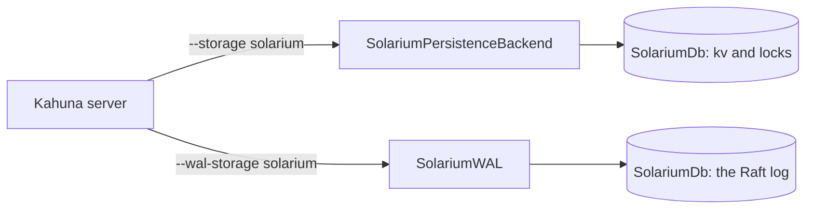
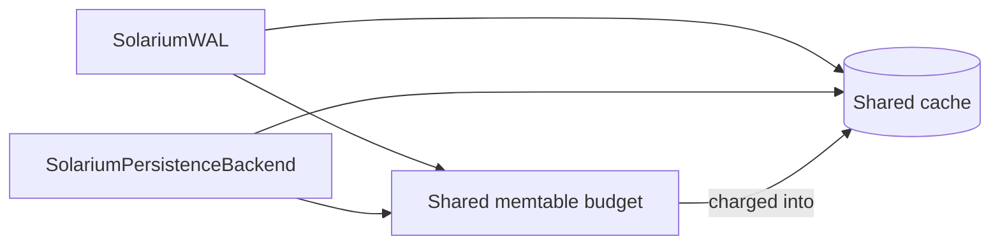

# Solarium.Kahuna

`Solarium.Kahuna` is a [Kahuna](https://kahunakv.github.io/) storage engine on Solarium. It stores both kinds of data of a Kahuna node, and the node needs no native RocksDB library.

| Kahuna option | Provider | Stores |
| --- | --- | --- |
| `--storage solarium` | `SolariumPersistenceBackendProvider` | The key-value and lock data, through `SolariumPersistenceBackend`. |
| `--wal-storage solarium` | `SolariumWalProvider` | The Raft log, through `SolariumWAL` from [Solarium.Kommander](kommander.md). |



The package is `SolariumDb.Kahuna`. Its assembly and its namespace are `Solarium.Kahuna`.

It needs Kahuna 1.16.4 or later. The package uses features that Kahuna added over several releases.

- 1.13.4 brought the public storage contract: `IPersistenceBackend` with immutable rows, and the `StorageProviders` registry of `IPersistenceBackendProvider` and `IWalProvider`.
- 1.14.1 brought the storage settings that pace the compactions.
- 1.14.2 brought the memory that the WAL and the store share.
- 1.14.4 brought the `--extension-option` settings, and the `System.IO.Hashing` version that Solarium uses.
- 1.15.3, with Kommander 1.13.1, brought the [storage-damage contract](#storage-damage) of the store and the WAL.
- 1.15.4 brought Kommander 1.13.2, whose snapshot installs no longer flood a follower with appends that it cannot apply.
- 1.16.4 brought `RevisionPruneResult.DeleteRecordsReleased`, the count of deleted keys whose rows the prune released.

## Load it into a Kahuna server

The Kahuna server loads the package as an **extension assembly**. Publish the package, then point the server at the published assembly.

```shell
dotnet publish src/Solarium.Kahuna -c Release -o /opt/kahuna/solarium

kahuna-server --extension-assembly /opt/kahuna/solarium/Solarium.Kahuna.dll \
              --storage solarium --storage-path /var/lib/kahuna/data \
              --wal-storage solarium --wal-path /var/lib/kahuna/wal
```

The published folder contains only what the server does not have: the Solarium assemblies, ioxide (the io_uring runtime), and `K4os.Compression.LZ4` for the LZ4 of the tables. That is about 4 MB. Kahuna.Core and Kommander are not in it, and neither are their dependencies. For an assembly that the server has, the loader always takes the copy of the server.

The nodes of a cluster all load the same artifact. The server logs the SHA-256 of each file and the engines that it registered.

## Choose the storage environment

By default, on all platforms, the WAL and the store use the default [storage environment](../architecture/storage-environments.md). On Linux, `--extension-option solarium.environment=io_uring` puts both on the [io_uring storage environment](../guides/io-uring.md).

```shell
kahuna-server --extension-assembly /opt/kahuna/solarium/Solarium.Kahuna.dll \
              --storage solarium --wal-storage solarium \
              --extension-option solarium.environment=io_uring
```

| Value | Storage environment |
| --- | --- |
| `default`, or no setting | The default storage environment. |
| `io_uring` | One `IoUringStorageEnvironment` for all the Solarium databases of the process. It lives as long as the process. It needs Linux with io_uring. |

Choose io_uring when lookups often miss the page cache. Its batched reads (`MultiGet`, which `GetKeyValues` uses) keep those misses in flight together. From the drive, they read 1.6 to 2.4 times as many keys. It costs 3% to 5% on batched reads that hit the page cache. Its writes go through one reactor thread, and they slow down when readers use all the CPUs. See [Storage Environments](../architecture/storage-environments.md).

The setting changes only how the files are read and written. The format of the files does not change. So you can change the setting between restarts.

A misspelled setting stops the node. A `solarium.` key other than `solarium.environment`, or a value other than `default` and `io_uring`, fails the open with a message that names it. On a machine that cannot create an io_uring ring, `io_uring` fails the open too.

## Pace the compactions

Two storage settings of Kahuna pace the compactions of the store.

| Setting | Effect |
| --- | --- |
| `--storage-compaction-rate-mbps` | Gives the store a `RateLimiter` of that rate for its flush and compaction writes. It also sets the compactions that run at once to `max(2, CPUs / 2)`, as in the RocksDB backend. |
| `--storage-max-background-compactions` | Sets the number of compactions that run at once. |

With neither, there is one compaction at a time and no pacing.

The limiter paces flushes too. So its rate must stay above what the store ingests, and below what leaves the disk free for the WAL syncs. On a disk whose synced writes took 4 to 8 ms, a rate of 50 made the synced batches of 64 rows 2.5 times as fast as one unpaced compaction. On the same disk at about 1 ms for each synced write, the synced batches wrote more than 25 and 50 MB/s. The flushes then held them to 0.2 to 0.4 times their unpaced rate. See [Pace background writes](../guides/flushes-and-compaction.md#pace-background-writes). Too low a rate lets level 0 grow until writes slow down.

## Share memory between the WAL and the store

Two settings give the WAL and the store of a node memory to share. Both providers take the `SharedStorageMemory` of the node, and use the same Solarium objects for it.

| Setting | Effect |
| --- | --- |
| `--storage-shared-cache-mb` | One `Cache` for the index and filter blocks of both, pinned at level 0. It takes the place of the process-wide cache of the store (below), and the WAL, which otherwise keeps its blocks in memory, joins it. Size it to hold the indexes and filters of both, about 2% of their table bytes and 4% with LZ4, plus the memtable budget. |
| `--storage-shared-memtable-budget-mb` | One `WriteBufferManager` for the memtables of both, as the shared write-buffer manager of the RocksDB pair. Past it, the database that writes next flushes its oldest memtable. It does not flush a memtable of the other database. No write stalls. With a shared cache, the budget is charged into the cache. One size then bounds both. |

Both are 0 by default. A Solarium WAL beside another store, or a Solarium store beside another WAL, uses them alone.

Size the memtable budget above 256 MiB, two of the 128 MiB shard memtables of the WAL. Below that, the WAL warns at open. A smaller budget flushes the memtables of the WAL before they fill.

Neither budget is on the managed heap, as with RocksDB. The memtables are in native arenas, and the cached data blocks of `CacheDataBlocks` are native memory. So a node sized for RocksDB needs no larger heap limit for the GC (`DOTNET_GCHeapHardLimit`) on Solarium. The index and filter partitions in the cache are on the managed heap, about 2% of the table bytes and 4% with LZ4. The memory for memtables is at most the memtable budget, plus one partly used chunk of 64 KiB for each processor and memtable.



## Register it in an embedded node

An embedded Kahuna node registers the providers in code.

```csharp
using Solarium.Kahuna;

EmbeddedKahunaOptions options = new() { Storage = "solarium", WalStorage = "solarium", /* paths... */ };
options.StorageProviders.Register(new SolariumPersistenceBackendProvider());
options.StorageProviders.Register(new SolariumWalProvider());
```

An embedded node gives the extension options in `EmbeddedKahunaOptions.ExtensionOptions`. A provider that you construct with an `IStorageEnvironment` uses that one, whatever the settings of the node. `OpenAt` and `MergeCheckpointInto`, which Kahuna calls for backups and restores, use the default storage environment, unless the provider has one from its constructor.

## What it keeps from the RocksDB backend

`SolariumPersistenceBackend` is a port of the `RocksDbPersistenceBackend` of Kahuna. The layout of the data and the behavior of the store come from that backend.

- the database at `{storage path}/{revision}`, with the column families `kv` and `locks`;
- the rows: the `RocksDbKeyValueMessage` and `RocksDbLockMessage` protobufs of Kahuna, from `Kahuna.Core`;
- the keys: `{key}~CURRENT` for the current row, `{key}~{revision}` for each retained revision, and `{key}~NOREV` for the no-revision provenance;
- the tilde-key registry and the durability floors;
- the pruned-history floor with its legacy key;
- revision pruning, with its memo and its sweep;
- the quiescence proof of the pruning;
- the release of a deleted key. The prune waits until age retention has passed the delete record of the key and no snapshot hold is older than it. Then the prune removes the rows of the key, except its current row. The next write of the key continues from the revision in that row;
- the scans, with the snapshot prefix scan and the seek over a deep revision run;
- the recovery from a storage failure: close and reopen in place, behind a swap fence;
- checkpoints: plain, exact as-of, key-filtered, and the merge of the share of one node into another;
- the storage-damage contract, which the [next section](#storage-damage) describes.

## Storage damage

A store with damaged files must not answer as if the data were absent, and a node must know when its store was lost or replaced. Kahuna 1.15 added a storage-damage contract to `IPersistenceBackend` for these cases. Its default members have no effect. `SolariumPersistenceBackend` implements the contract, as the RocksDB backend does.

- **Fail-stop on damage.** The first `SolariumException` with `IsCorruption`, from any read, batched read, scan, write, or open, stops the store on purpose, with one Critical line. All later operations throw `StorageCorruptionException`. Kahuna answers it with the terminal `StorageCorrupt`, not `MustRetry`. The store methods return false. `GetFailStopReason` names the damage. `TryRecoverFromStorageFailure` declines. It does not close or reopen the store, and the files do not change. An iterator throws at a damaged block. This means that a scan does not end short.
- **What the node does.** Kahuna withholds candidacy and steps down the partitions that the node hosts. Its storage health shows the fault. A damaged open throws `StorageCorruptionException`, and the node does not start.
- **Durability floors.** `KeepsDurabilityFloors` is true. The store keeps the floors that it is given. This means that a data partition with none was never flushed here, and Kahuna answers 0 for it. Kommander can then refuse to replay a compacted suffix onto a store that lost its prefix. A floor row that is not 8 bytes is damage: it fails the open, and a read of it stops the store.
- **Store identity.** `SupportsStoreIdentity` is true. The identity is the Raft endpoint of the node, a creation id, and a time, in a synced row in the reserved `\0` namespace (`\0store_identity`). No scan sees it, and it is not durable state (`HoldsDurableState`). Kahuna stamps a fresh store at its first open, and also a store written before the identity existed. A store stamped by another node is refused. A store found empty under a log with history is reported as lost or replaced. A row that does not decode is damage.
- **Restores and seeds.** An as-of image and a merge carry no identity. The node that opens one stamps it. A plain checkpoint is a copy of the store of the node and has the same identity, as in the RocksDB backend.

## Differences from the RocksDB backend

- **The prune writes unsynced batches.** The deletes of one prune call go in shared batches of up to 2,048 rows, with the pruned-history floor that they need, and are not synced. A power loss that takes a batch takes its floor with it, and the next pass deletes the rows again. When a sweep cycle ends, the prune asks for a flush of the `kv` column family and does not wait for it.
- **No compaction that starts from deletes.** The RocksDB backend marks a `kv` table for compaction when half of its entries are deletes (`CompactOnDeletionCollector` of RocksDB). The deletes of the prune then reach the rows that they cover, even when there are no other writes. Solarium picks compactions by level size only. On a store with no other writes, the deletes of a released key space stay in a table above the rows that they cover. The store gives back the space only when later writes push them down.

- **Only index and filter blocks are cached.** Without `--storage-shared-cache-mb`, the tables of the store keep their index and filter blocks in a 256 MiB cache that the Solarium stores of the process share, pinned at level 0. The RocksDB backend uses its process-wide 256 MiB block cache for them. Data blocks do not go in the cache. The backend does not set `CacheDataBlocks`, and the page cache of the operating system serves them. 256 MiB is enough for the indexes and filters of about 12 GB of tables, or 6 GB with LZ4. Past that, a lookup that misses reads one partition of the index and filter of its table again, a few kilobytes. With a cache of a quarter of them, lookups from one thread ran about 2.5 times slower. Tables written before partitions have an unpartitioned index and filter until a compaction rewrites them, and a miss on one of them reads all of it.
- **No RocksDB tuning.** Direct reads and statistics do not apply, and neither do the Bloom filter settings and `--rocksdb-shared-memory`. The shared cache and memtable budget above do. The tables of Solarium have a fixed 10-bit Bloom filter. The `kv` column family has a 64 MiB memtable with up to three. The `locks` column family has 8 MiB with up to two. These are the sizes of the RocksDB backend.
- **Checkpoints hold no WAL.** A checkpoint is `SolariumDb.CreateCheckpoint`. Its tables are hard links to those of the store, as in RocksDB. They are copies when the checkpoint is on another file system. The data in the memtables goes to tables of the copy, and the live store is not flushed. A live checkpoint is staged on the file system of the store, as in the RocksDB backend (`StagesLiveCheckpointsInStore` is true).
- **LZ4, and one compaction thread unless paced.** Both column families compress their tables with LZ4. The RocksDB backend uses Snappy, the default of RocksDB. Solarium compacts into the levels of RocksDB, sized as RocksDB sizes them. Without `--storage-compaction-rate-mbps`, there is one compaction at a time. The RocksDB backend has `max(2, CPUs / 2)`. Several unpaced compactions take the disk from synced writes and slow them.
- **The trim is not rate limited.** The `RateLimiter` of Solarium paces flush and compaction writes only. `BackupCaptureThrottleBytesPerSec` also counts the reads of the trim (`kAllIo` in RocksDB). So the backend does not apply it to the as-of trim of a checkpoint copy.
- **The purge flushes first.** The `CompactRange` of Solarium does not flush a memtable first. So the trim and the merge flush each column family before they compact it.
- **The rows of a key go with one range tombstone.** `DeleteKeyValues` and `DeleteLocks` delete the rows of each key, `key~` up to `key\x7F`, with one `DeleteRange`. The RocksDB backend walks the rows and deletes each one. The same rows go. The batch has one operation for each key, whatever the number of its history rows. A purge of a partition before a snapshot install deletes 256 keys in each call. With one delete for each row, a store with millions of history rows built them all on the managed heap at once, and the node ran out of memory. The batch of the RocksDB backend is native memory.
- **Batched reads read one column family for each call.** The `MultiGet` of Solarium reads one column family for each call. The batched reads here read the `kv` column family only.

## Build against Kahuna

`Solarium.Kahuna` references the `Kahuna.Core` package from nuget.org. For an assembly that the server has, the loader gives the extension the copy of the server. So the `Kahuna.Core` of the server must have at least the assembly version that this package was built against. A server older than the referenced `Kahuna.Core` cannot load the extension.

Raise the reference only to a Kahuna release that the servers that load it already run.

## Performance

The [Kahuna benchmarks](../operations/benchmarks.md#the-persistence-backend-of-kahuna-against-rocksdb) compare both backends. Loads, synced batches, and reads from the page cache were faster on Solarium. Misses on the small stores were slower.

- With its tables in the page cache, Solarium made 1.05 to 1.8 times the gets and scans of RocksDB through the page cache on the `large` dataset, and 1.4 to 1.95 times on `history`. Misses on the small stores were slower, at 0.68 to 0.99 times.
- Loads and synced batches ran 1.07 to 1.32 times as fast. The drive limits synced writes of one row, whatever the engine.
- With less memory than the store, gets and scans were 1.2 to 1.8 times as fast, but writes were slower on the default storage environment.
- With LZ4, the store is the same size as that of RocksDB. The compactions after a load wrote more bytes than those of RocksDB, and the store took longer to go quiet.
- A plain checkpoint takes about 0.04 s, as it links the tables.

## Tests

The behavior tests of the RocksDB backend of Kahuna, ported to `SolariumPersistenceBackend`, are in `tests/Solarium.Kahuna.Tests`. The project also tests storage damage.

- the backend tests of `TestPersistenceBackends`;
- revision pruning: the memo and the time budget;
- the sweep quiescence and the snapshot floor of the pruning;
- the release of deleted keys;
- as-of reads: revision at or before, probes, run seeks, prefix scans, batched gets, the monotonic current head, and no-revision writes;
- as-of checkpoints and the pruned-history floor;
- the key-filtered composition and the merge of checkpoints;
- the recovery from a storage failure;
- `TestStorageCorruption`, which damages real files on both storage environments. A flipped byte in a data block makes a range scan, a point read, a batched read, and a whole scan of a column family throw `StorageCorruptionException`. All later operations on the store fail, and it declines the recovery with its files unchanged. A truncated table, a floor row of the wrong length, and an identity row that does not decode are refused;
- `TestStorageCorruptionNode`, which uses an embedded node with a Solarium store and WAL. A damaged block answers the first read with `StorageCorrupt` and takes the node out of consensus. A single node whose store directory was lost under a surviving log reports it as replaced, and rebuilds it from the log.

When the log was compacted below a checkpoint before the store was lost, the floor of the store, 0, is below the compaction floor of the log. A single node then refuses the replay, with the state `ApplicationFloorBelowCompaction`. It does not lead. This means that it answers no read with a missing key. In a three-node cluster, the follower that lost its store is rebuilt from the snapshot of the leader before it leads. Both tests fail when the store declares no floors.

`TestDeletedKeyDiskRelease` starts a node whose prune releases a deleted key with no other write. Then it restarts the node and writes the key again above its delete record. `TestPruneWriteFailure` fails the first batch of a sweep on both storage environments. No row and no floor moves. The pass after the recovery releases all the keys, and the result is the same after a reopen.

Three ported tests are skipped. The two cases of `DeletedKeySpace_GivesItsDiskSpaceBack_WithNoOtherWrites` need a compaction that starts from deletes. `DeleteRecordInsideTheRetentionAge_KeepsItsHistoryRow_UntilTheAgePassesIt` needs age retention to count the age of a revision from the commit of the revision that replaced it. This store and the released RocksDB backend count it from the commit of the revision itself.

A recovery test injects a write failure through `HookedEnvironment` on the default and io_uring storage environments. The other ported tests run on the default storage environment, as those of Kahuna do.

From end to end, a Kahuna server loaded the published extension and took writes over REST on `--storage solarium --wal-storage solarium`. It read every key back after a SIGKILL and a restart. The same run on RocksDB gave the same result.
