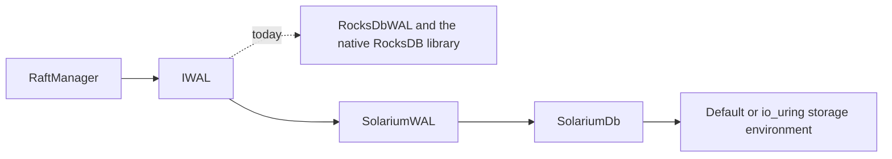
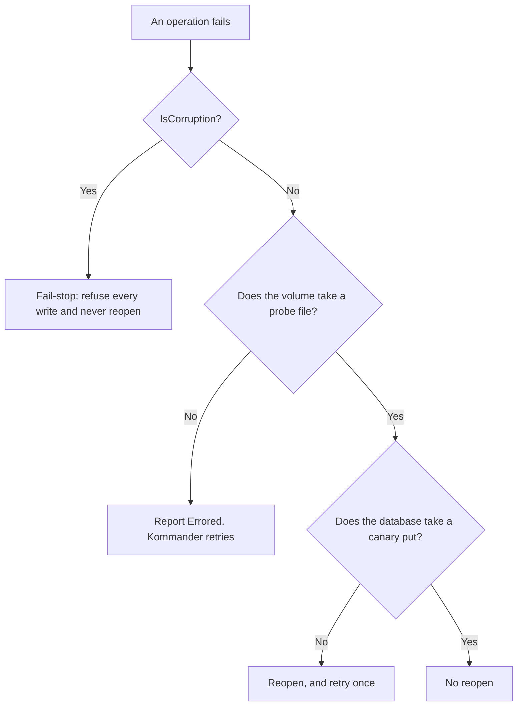

# Solarium.Kommander

`Solarium.Kommander` is a [Kommander](https://kahunakv.github.io/kommander.github.io/) write-ahead log on Solarium. `SolariumWAL` implements the `IWAL` interface of Kommander. A host passes it to `RaftManager` in place of `RocksDbWAL`, with no change to Kommander and no native library to ship.

It targets Kommander 1.13.2 and .NET 10. Install it from NuGet:

```shell
dotnet add package SolariumDb.Kommander
```

This is version 0.1.7, so the on-disk format can still change.



## Use it

Add the package, then create the WAL and pass it to `RaftManager`:

```csharp
using Kommander;
using Kommander.Discovery;
using Kommander.Time;
using Solarium.Kommander;

using SolariumWAL wal = new("/var/lib/node1/raft", "v1", logger, syncWrites: true);

RaftManager raft = new(configuration, new StaticDiscovery(peers), wal, communication, new HybridLogicalClock(), logger);
```

The constructor parameters:

| Parameter | Meaning |
| --- | --- |
| `path` | The base directory. The WAL lives in `{path}/{revision}`, which is created when it does not exist. One process opens it at a time. |
| `revision` | The name of the subdirectory, for example `"v1"`. |
| `logger` | An `ILogger<IRaft>`. |
| `syncWrites` | True by default. See [Durability](#durability). |
| `options` | A `SolariumWalOptions`, or null for the defaults. See [Options](#options). |

`RaftManager` disposes its WAL when it is disposed.

### io_uring

On Linux, the `SolariumDb.IoUring` package writes the files through io_uring. Pass the environment through the options. The host owns the environment, and disposes it after the WAL:

```csharp
using Solarium.IoUring;
using Solarium.Kommander;

using IoUringStorageEnvironment environment = new();
using SolariumWAL wal = new(path, "v1", logger, syncWrites: true, new SolariumWalOptions { Environment = environment });
```

io_uring matches the default storage environment on synced writes, because their fsync does not go through the ring. It is slower on unsynced writes, because each write is a hand-off to the reactor thread. Reads use `pread` on the calling thread in both environments. See [io_uring on Linux](../guides/io-uring.md).

## Durability

- `syncWrites: true`, the default: a write is flushed to the disk before `Write` returns, so it survives a power loss.
- `syncWrites: false`: a write reaches the operating system before `Write` returns, so it survives a process crash but not a power loss. This is the same as in `RocksDbWAL`.
- Hard state (the term and the vote) goes through `SetMetaData`, which is not synced, as in `RocksDbWAL`. The `IWAL` interface of Kommander documents that choice.

## What it keeps from RocksDbWAL

`SolariumWAL` is a port of the `RocksDbWAL` of Kommander (commit `1bee500`, the release 1.11.3, and its storage-damage contract at commit `e2763bc`, the release 1.13.1). It is not a new design. It keeps:

- the column families `default`, `metadata`, and `shard0` to `shard7`. Partition `p` goes in `shard{p % 8}`;
- one row for each log entry, under the key `{partition:D10}:{id:D20}`. The row holds the `RaftLogMessage` protobuf encoding, written and read by hand as `RocksDbWAL` does;
- the metadata keys of each partition: the last checkpoint, the commit frontier, and the compaction floor, and the hard state and HLC floor that Kommander writes through `SetMetaData`;
- the format version `2.0.0` in the `version` metadata key, checked at open;
- the commit frontier, the compaction floor, and the snapshot boundary;
- the [storage-damage contract](#storage-damage), with its metadata keys and its two ledger files.

Some terms in this list:

- The **commit frontier** is the highest committed log id of a partition. A commit marker is a small metadata put, not a rewrite of the row.
- The **compaction floor** is the log id below which the log is dead. The dead prefix is removed by the floor, a range delete in the active memtable, and whole-file drops with `DeleteFilesInRange`. See [Range Deletes](../guides/range-deletes.md#the-raft-log-pattern).

`SolariumWAL` also fixes two bugs of `RocksDbWAL` at that commit. Kommander 1.12.0 made the same two fixes to `RocksDbWAL`. So neither fix is a difference from the release that `SolariumWAL` targets:

- **The header reader skips length-delimited fields correctly.** In the `RocksDbWAL` of 1.11.3, `ReadHeaderFromWire` and `ReadTermFromWire` skip a length-delimited field one byte short. Then a `Proposed` row with the log type `op` and a 32-byte payload reads with the first byte of the payload as its type, and the proposed-tail sweep can keep an uncommitted entry. `SolariumWAL` reads the length first, and refuses a length past the end of the row.
- **The commit frontier never moves back under concurrent commits.** In the `RocksDbWAL` of 1.11.3, two commits of one partition that overlap can land in the opposite order. After a reopen, the commits that the higher advance absorbed read `Proposed`. `SolariumWAL` serializes the advances of each partition (see [Concurrency](#concurrency)).

The rows and keys are the same bytes, but the files are those of Solarium. A `RocksDbWAL` directory does not open as a `SolariumWAL` directory, and the reverse is also true. To move a node from one to the other, copy the rows. This package does not do that for you.

## Options

`SolariumWalOptions` sets the shard tuning, as `RocksDbWalTuning` does for RocksDB:

| Option | Default | Meaning |
| --- | --- | --- |
| `ShardWriteBufferSizeBytes` | 128 MiB | The memtable size of each shard: the flush unit. The RocksDB tuning merges two 64 MB memtables for each flush. Solarium does not merge memtables, so one 128 MiB memtable is the same unit. A larger unit writes less, because rows that a compaction pass deletes while they are in the memtable never reach an SSTable. |
| `ShardMaxWriteBufferNumber` | 3 | The memtables that a shard holds before writes wait for a flush. At least 2. |
| `ShardLevel0FileNumCompactionTrigger` | 8 | The level 0 files of a shard that start a compaction. |
| `ShardLevel0SlowdownWritesTrigger` | 28 | The level 0 files of a shard that slow writes. |
| `ShardLevel0StopWritesTrigger` | 44 | The level 0 files of a shard that stop writes. |
| `MaxBackgroundCompactions` | the compactions of `clamp(CPUs / 2, 2, 8)` background jobs: 6 on 16 CPUs | The compactions that run at once. This matches the `max_background_jobs` of `RocksDbWAL`, which RocksDB splits into a quarter for flushes and the rest for compactions. |
| `MaxTotalWalSizeFlushUnits` | 2 | The WAL size cap, in flush units. Past it, the column families that keep the oldest WAL file are flushed, so a shard with few writes does not keep every WAL file. 0 keeps the default of Solarium. |
| `WriteBufferManager` | none | A cap on the memtables of the WAL and of the other Solarium databases of the host together. Past the cap, the database that writes next flushes its oldest memtable. The host owns it. |
| `BlockCache` | none | A cache for the index and filter blocks of every column family of the WAL, pinned at level 0. It bounds the memory of the open tables, which otherwise grows with the log on disk. Give the `WriteBufferManager` the same cache to put the memtables under the same capacity. The host owns it. |
| `Environment` | the default storage environment | Where the files go. |
| `TickSource` | the system clock | The clock of the failure log cadence and of the probe interval. |

A partition that owns its shard writes files that do not overlap. So they move down the levels with no rewrite.

## Concurrency

Every member is safe to call from any thread.

- **Appends** hold the shared side of a write guard. So they overlap, and the group commit of Solarium joins their WAL flushes.
- **Scan-then-delete operations** (the truncations and the snapshot boundary), and appends that carry a checkpoint, hold the exclusive side. So an append cannot land between their scan and their batch.
- **Commits** also hold a lock for each partition that they commit, in partition order, from the read of the commit frontier to the write of the new one. A partition delete holds it for its write. So an advance computed from an old frontier cannot land after a newer one.

Appends to other partitions, and appends without commit markers, do not wait for the partition lock.

## After a storage failure

A failed write stops every later write of a Solarium database until it opens again. `SolariumWAL` first looks at the kind of failure. Damage to the files is [corruption](#storage-damage), and a reopen does not repair it. For any other failure, it asks two questions:

1. Does the volume take a small durable write? It writes a probe file through the storage environment.
2. Does the database take a write? It writes a canary put.

Only when the volume takes the write and the database does not, does `SolariumWAL` close the database and open it again. Then it retries the operation once.

- While the volume still refuses writes, for example because the disk is full, every write reports `Errored` and nothing reopens. Kommander retries on its own cadence.
- A reopen that fails leaves the WAL closed. The next failed write tries again.
- Nothing acknowledged is lost. Synced writes were flushed, and unsynced writes reached the operating system.



## Storage damage

A Raft node must not forget a vote, and must not lose a synced log entry without knowing it. A node that forgets a vote can grant a second candidate the same term after a power loss. Kommander 1.13 added a storage-damage contract to `IWAL` for these cases, with default members that do nothing. `SolariumWAL` implements every member, as `RocksDbWAL` does.

- **The term and vote are flushed before they count.** `SetMetaData`, and so `PersistHardState`, writes synced under `syncWrites`. A vote reply leaves after `PersistHardState` returns. `PersistHardState` also appends the term and vote to the hard-state ledger, and reports them durable only when both writes landed.
- **The acknowledged-presence watermark.** `Write(logs, sync, acknowledgedPresence)` puts, in the batch of the rows, the highest id of each partition that the node will have reported as contiguously held. A truncation, the sweep of `Proposed` rows, and a truncating snapshot boundary clamp it. A snapshot boundary above the log raises it. A partition delete removes it. Kommander quarantines a partition whose restored log is shorter than its watermark.
- **The sync ledger.** A WAL file cut after its fsync leaves no later record that proves the cut. So Solarium opens it short and clean, and the watermark, term, and vote inside it go with the rows. `.kommander-sync-ledger` holds the proof outside that file. After every synced write, before the write returns, it records the last sequence number of the batch (`WriteBatch.Sequence`) in one of two 512-byte slots, written in turn and each flushed.
- **The verdict.** At open, a ledger ahead of what the database replayed is a lost-synced-writes verdict. The WAL persists it, and every partition carries it (`GetLostSyncedWritesReason`) until Kommander reconciles it from a leader (`MarkLostSyncedWritesReconciled`). The WAL keeps taking writes, because replication repairs a lost tail.
- **The hard-state ledger.** `.kommander-hard-state` holds the last term and vote of each partition, appended after the put to the database. At open, a term or vote that it holds ahead of the database is written back before Kommander reads the hard state. A torn last record is cut. Past 256 KiB, the file is rewritten with one record for each partition.
- **Fail-stop on damage.** A `SolariumException` with `IsCorruption`, from any read, write, reopen, or open, stops the WAL on purpose. It logs one Critical line and adds to `raft.wal.engine_fail_stops_total`. Every later write is refused as `Errored` without touching the database. The recovery neither probes nor reopens. `GetFailStopReason` names the damaged file. Reads continue, and a read of the damage throws again. An iterator throws at a damaged block, so no scan ends short as if the log ended there.

Kommander then moves the partitions to `EngineFailed`, and a leader steps down. A restore that reads the damage reports `RestoreFailed`, which also withholds candidacy. A damaged open throws, so the node does not start.

These are not a loss, and report no verdict: a ledger of another database (it is reset), a torn slot (the other slot is read), an unreadable ledger (it starts over with a warning), and a directory from before the ledgers (it is upgraded).

The limits:

- **The ledger attests synced writes only.** With `syncWrites` off, nothing is attested after the open. With the default of Kommander, a batch of commit markers is written unsynced. A follower that first meets an entry already committed can write its row in such a batch and acknowledge it. A cut can then take only writes that were never synced, which no ledger can tell from a torn tail. The test of a repaired follower runs with `WalSingleFsyncCommit` off, so that every write is synced.
- **Each synced write costs one more flush.** Concurrent writers share it: the first one through writes the target of all of them. The [benchmark results](../operations/benchmarks.md#the-kommander-wal-against-rocksdb) come before this flush.
- **The repair moves the ledgers too.** The repair for damage is to move the directory aside and let the node rebuild from its peers. The ledgers are in that directory, so the node then remembers neither its term nor its vote. The same is true of `RocksDbWAL`.
- **Erased database files.** The database ignores files whose names start with `.`. So a directory whose database files were erased while the ledgers survived opens as a new database, with a verdict whose reason says that the format version is gone too.

## Metrics

Kommander publishes its `raft.wal.*` instruments on its meter, `"Kommander"`. Most of them come from Kommander itself, whatever the WAL: batches, operations, batch size, queue depth, the oldest pending write, write duration, and compaction passes.

Kommander connects the instruments that read the storage engine to `RocksDbWAL` only. So `SolariumWAL` publishes them on its own meter, `SolariumWalMetrics.MeterName` (`"Solarium.Kommander"`), with the same names, units, and meanings. A host listens to both meters:

```csharp
builder.Services.AddOpenTelemetry().WithMetrics(metrics => metrics
    .AddMeter("Kommander")
    .AddMeter(SolariumWalMetrics.MeterName));
```

| Instrument | Kind | Value |
| --- | --- | --- |
| `raft.wal.delayed_write_rate` | gauge, By/s | The rate that writes slow down to, or 0 (`rocksdb.actual-delayed-write-rate`). |
| `raft.wal.write_stalled` | gauge | 1 while writes are stopped, else 0 (`rocksdb.is-write-stopped`). |
| `raft.wal.shard_live_sst_bytes` | gauge, By | The live SSTable bytes of the shard column families. |
| `raft.wal.shard_l0_files`, `raft.wal.shard_l6_files` | gauge | The SSTables of the shard column families in level 0 and in level 6, the bottom level. |
| `raft.wal.table_readers_memory` | gauge, By | The bytes that the open SSTables keep in memory: range tombstones, and index and filter blocks unless the block cache holds them. |
| `raft.wal.block_cache_usage` | gauge, By | The bytes in the block cache of the WAL, the whole cache when it is shared. Only with `SolariumWalOptions.BlockCache`. |
| `raft.wal.block_cache_pinned_usage` | gauge, By | The bytes of that cache that cannot be evicted: level 0 index and filter blocks, and memtable charges. |
| `raft.wal.memtable_memory` | gauge, By | The bytes of the memtables of every column family, flushing ones included. |
| `raft.wal.alive_log_bytes` | gauge, By | The bytes of the WAL files in the database directory, which a restart replays. |
| `raft.wal.engine_reopens_total` | counter | Reopens of the database to clear a storage failure, tagged `outcome`: `success` or `failed`. |
| `raft.wal.engine_fail_stops_total` | counter | WALs that fail-stopped on storage damage, or refused to open on it. |
| `raft.wal.lost_synced_writes_total` | counter | Opens whose sync ledger attested synced writes that the replayed log no longer holds. |

Each open `SolariumWAL` reports one measurement for each gauge, without tags, as each `RocksDbWAL` does. It stops at `Dispose`. The two block cache gauges come only from a WAL with a `SolariumWalOptions.BlockCache`, and report the whole cache, as those of `RocksDbWAL` report its shared cache. The instruments cost nothing while no listener is attached.

## Differences from RocksDbWAL

- **The shared resources are two options.** `SolariumWalOptions.WriteBufferManager` is the write-buffer manager of `RocksDbSharedResources`. The WAL warns at open, as `RocksDbWAL` does, when its cap is below two shard memtables. `SolariumWalOptions.BlockCache` holds the index and filter blocks of every column family, pinned at level 0, as `RocksDbWAL` sets them on its shared path. A `WriteBufferManager` created with the same cache puts the memtables under its capacity too, as `CreateWithUnifiedBudget`. The cache holds no data blocks. The scans of dead rows (`CountPersistedLogs`, and the count of a compaction pass) read with `FillCache` off, as in `RocksDbWAL`.
- **The engine gauges are on a second meter.** A host adds the `"Solarium.Kommander"` meter. A WAL without a block cache reports no block cache gauges.
- **A write after `Dispose` throws** `ObjectDisposedException`, as a read does. `RocksDbWAL` reports it as a storage failure first and probes the volume of the closed WAL.
- **A new WAL is one whose database holds nothing.** `RocksDbWAL` takes a WAL as new when its directory does not exist, and refuses an existing directory without a `version` key. So a directory that a host created first never opens, and neither does one that a crash left during the first open. `SolariumWAL` writes the version synced, before any row, and refuses only a database that holds data without a version.
- **A deleted WAL file is refused at open.** The manifest of Solarium lists every live WAL file, also the one in use. So the database refuses to open on a missing one, as corruption. `RocksDbWAL` tracks its closed logs only (`track_and_verify_wals_in_manifest`), opens on its tables alone when the live log is gone, and finds the loss through its sync ledger. In both, the sync ledger finds a cut WAL file.
- **The ledger is bound at a synced mark.** At open, `RocksDbWAL` binds its ledger at the latest sequence number of the engine. With `syncWrites` off, that includes the unsynced metadata puts of the open, so a power loss right after the open reads as lost synced writes at the next one. `SolariumWAL` binds it at the sequence number of a synced canary write, which makes everything before it durable.
- **The fail-stop reason names the damage.** A write that Solarium refuses after a compaction met damage says only that writes stopped. `GetFailStopReason` adds the messages of the failures that it wraps, which name the table and the offset. `RocksDbWAL` reports the status text, which names the file.
- **The WAL file after a flush.** Solarium starts a new WAL file at the first write after a flush, not at the flush. So a closed WAL keeps its last file until then.

## Tests

`tests/Solarium.Kommander.Tests` holds:

- the conformance suite of Kommander for `IWAL` backends, copied with no change from the same commit;
- the behavior tests of the `RocksDbWAL` suites of Kommander, ported to `SolariumWAL`: reads and writes, checkpoints, the commit frontier, the compaction floor and its file layout, truncation and the snapshot boundary, the torn WAL tail, and the recovery after a write failure;
- `WalCrashTests`, which crashes a `SolariumWAL` at random storage operations of a random Kommander workload, and compares it with a second `SolariumWAL` that never crashes;
- `ClusterTests`, which runs Kommander clusters of three nodes in one process, each node on its own `SolariumWAL`;
- `MetricsTests`, which reads the instruments through a `MeterListener`;
- `LostSyncedWriteTests`, which cuts the newest WAL file after its fsync, deletes it, erases the database files under the ledgers, and cuts a vote off the tail. It checks each verdict, and that a torn unsynced record, a clean reopen, and a copied, torn, or unreadable ledger report no loss;
- `StorageDamageTests`, which checks that a vote is durable only after its flush, the watermark through every path that changes it, and the fail-stop on damage that a read, a write, a compaction, and the open find;
- `StorageVerdictTests`, which runs those verdicts through a `RaftManager`. A single voter whose WAL was cut never leads until the loss is accepted. A follower whose WAL was cut is quarantined and repaired by its leader. A leader whose WAL meets damage steps down while another node leads.

Each test runs on the default and the io_uring storage environment. [Testing](../operations/testing.md) describes the crash tests, and [Benchmarks](../operations/benchmarks.md#the-kommander-wal-against-rocksdb) compares the write path with `RocksDbWAL`.
