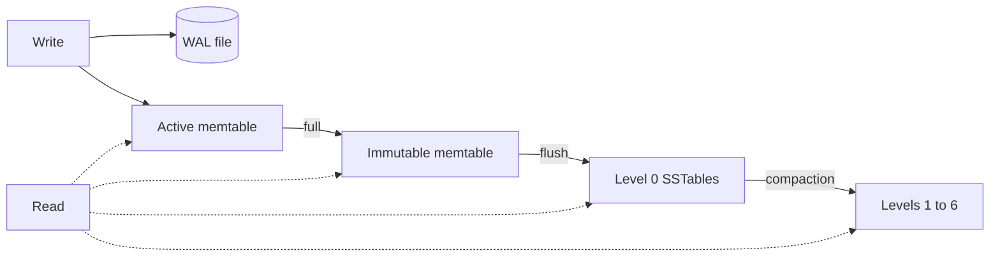

# Solarium

Solarium is an embedded key-value store for .NET, written in managed code. Its design and its API follow [RocksDB](https://rocksdb.org/). A database is one directory on disk. Your process opens that directory, and reads and writes it directly. There is no server and no network protocol.

Solarium exists to be a durable log store for [Kommander](https://kahunakv.github.io/kommander.github.io/), the Raft library for .NET. It covers the part of RocksDB that the Raft log of Kommander uses, and RocksDB is the reference behavior. A host can plug Solarium into Kommander in place of RocksDB, with no native library.

:::note A young database
Solarium is a brand-new database, at version 0.2.1. Its on-disk format can still change. Read [What is not done yet](#what-is-not-done-yet) before you use it for data that you cannot lose.
:::

## In simple terms

If you append each change to a file and call fsync, a write is durable, but a read must scan the file. A sorted collection in memory, such as a `SortedDictionary`, reads fast but loses everything in a crash. Solarium combines an append-only file with sorted structures in memory and on disk.

1. A write goes first to a **write-ahead log (WAL)**, a file that only grows. After a crash, the WAL tells the database what to replay.
2. The write then goes into a **memtable**, a sorted structure in memory.
3. When the memtable is full, a background thread writes it to disk as a **sorted string table (SSTable)**, a sorted file that does not change after it is written.
4. A background **compaction** merges SSTables. Old versions and deleted keys go away, and reads search fewer files.
5. A read searches the memtables before the SSTables, and it searches the SSTables from the newest to the oldest. The first version of the key that it finds is the answer.



This design makes writes fast. A write is one append and one insert in memory. The design also makes crash recovery simple. Every write that is not in an SSTable yet is in the WAL.

## What you get

| Feature | What it means for you |
| --- | --- |
| **Column families** | Named, ordered key spaces in one database, like separate tables in one SQLite file. They share one WAL. This means that one batch can write to several of them atomically. |
| **Atomic write batches** | A `WriteBatch` applies all its puts, deletes, and range deletes, or none of them, like a transaction that only writes. |
| **Synced and unsynced writes** | A synced write survives a power loss when `Write` returns. An unsynced write survives a process crash. |
| **Range deletes** | `DeleteRange` deletes a key range with one write. A single range tombstone covers the range. |
| **Ordered iterators** | Seek to a key, and step forward or back from it. You can set an upper bound. |
| **Leveled compaction** | The seven levels of RocksDB, with its dynamic level sizing. |
| **Checkpoints** | A consistent copy of the database in a new directory, with hard links to the SSTables. |
| **Group commit** | Writes from many threads share their WAL appends and flushes. |
| **Lock-free reads** | Reads take no engine locks, on a lock-free skip-list memtable. |
| **Block cache and memtable budget** | One cache for the index and filter blocks, and for the data blocks if you want, and one cap on the memtables. Several databases can share both. |
| **Storage environments** | All file I/O goes through an interface. The default works everywhere. An io_uring storage environment is available for Linux. |

You can call the members of `SolariumDb` from any thread. Use each `Iterator` and each `WriteBatch` from one thread at a time.

## Packages

| Package | What it is |
| --- | --- |
| `SolariumDb` | The store. Managed code, for any platform with .NET 10. Its memtables and cached data blocks are native memory, outside the managed heap, as in RocksDB. |
| `SolariumDb.IoUring` | A storage environment for Linux 6.1 or later that does its file writes through io_uring, on the [ioxide](https://github.com/MDA2AV/ioxide) runtime. A `MultiGet` also sends the reads that the page cache misses to the ring together. |
| `SolariumDb.Kommander` | `SolariumWAL`, a Kommander `IWAL` on Solarium, with the on-disk layout of the `RocksDbWAL` of Kommander. |
| `SolariumDb.Kahuna` | A [Kahuna](https://kahunakv.github.io/) storage engine: the persistence backend and the Raft WAL on Solarium. A Kahuna server loads it with `--extension-assembly`. |

All four packages are on [NuGet](https://www.nuget.org/packages/SolariumDb) and MIT-licensed. The namespaces and the assemblies keep the names `Solarium`, `Solarium.IoUring`, `Solarium.Kommander`, and `Solarium.Kahuna`.

## A first look

```csharp
using System.Text;
using Solarium;

using SolariumDb db = SolariumDb.Open("./data",
    new DbOptions { CreateMissingColumnFamilies = true },
    columnFamilies: ["metadata"]);

ColumnFamily metadata = db.GetColumnFamily("metadata");

// All or nothing, across column families. Synced, so it survives a power loss once Write returns.
db.Write(new WriteBatch()
    .Put("log:0001"u8, "entry"u8)
    .Put("last"u8, "0001"u8, metadata),
    WriteOptions.Synced);

byte[]? value = db.Get("log:0001"u8);

using Iterator iterator = db.NewIterator(options: new ReadOptions { IterateUpperBound = "log;"u8.ToArray() });
for (iterator.Seek("log:"u8); iterator.Valid(); iterator.Next())
    Console.WriteLine(Encoding.UTF8.GetString(iterator.Key()));

db.DeleteRange("log:0000"u8, "log:0001"u8);
```

[Getting Started](getting-started.md) explains each line of this example.

## What is done

- The embedded API, with column families and atomic batches across them.
- `DeleteRange`, and iterators with an upper bound.
- Group commit with pipelined writes, and lock-free reads on a skip-list memtable.
- WAL recovery that cuts a torn tail. The open fails on damage to flushed data. Power-loss tests and kill tests check the recovery.
- SSTable checksums bound to the table and the offset of each block, data blocks checked against their index entries, and opens that refuse a table file that the manifest does not record. All are reported as corruption (`SolariumException.IsCorruption`).
- Memtable flushes to SSTables, with LZ4 block compression.
- WAL rotation with a size cap, and the manifest.
- Leveled compaction into the seven levels of RocksDB with its dynamic level sizing, up to `MaxBackgroundCompactions` compactions at once.
- A rate limiter and `BytesPerSync` for flushes and compactions.
- A memtable budget shared across databases (`WriteBufferManager`).
- A block cache that bounds the memory of the index and filter blocks. It can hold the memtable budget too, and it caches data blocks when you ask.
- `DeleteFilesInRange`, checkpoints, and write stalls.
- The RocksDB properties and the live-file metadata that Kommander reads.
- `Solarium.Kommander`. It passes the conformance suite of Kommander for WAL backends and the behavior tests of its RocksDB backend. The tests also use it in three-node Kommander clusters. It publishes the engine `raft.wal.*` metrics. It implements the storage-damage contract of Kommander: the term and vote flushed before they count, the acknowledged-presence watermark, a sync ledger and a hard-state ledger that find a WAL file cut after its fsync, and a fail-stop on corruption.
- `Solarium.Kahuna`, a port of the RocksDB persistence backend of Kahuna that passes its behavior tests. A Kahuna server loads its providers as an extension for `--storage solarium` and `--wal-storage solarium`. It implements the storage-damage contract of Kahuna, with a fail-stop on corruption and declared durability floors. The store is also stamped with the identity of its node.

## What is not done yet

- **Recovery from an engine failure without a reopen.** A WAL, flush, or compaction failure stops all writes until you open the database again. `SolariumWAL` and the Kahuna store reopen it automatically, except after corruption, on which they fail-stop.
- **A cache for data blocks that pays on stores larger than the cache.** With the LRU cache, `CacheDataBlocks` made reads faster on a store that fits in the cache, but slower on a store ten times its size. For this reason it is off by default, and the page cache of the operating system serves the data blocks.
- **Subcompactions and more than one flush thread.** One merge always runs on one thread, as with `max_subcompactions` of 1 in RocksDB. Flushes have one thread.

## Where to go next

| If you want to | Read |
| --- | --- |
| Know why Solarium exists and when to use it | [Benefits and Limits](why-solarium.md) |
| Learn the storage terms that these docs use | [Key Concepts](concepts.md) |
| Open a database and write your first batch | [Getting Started](getting-started.md) |
| Use Solarium as the Raft log of Kommander | [Solarium.Kommander](integrations/kommander.md) |
| Run a Kahuna node on Solarium | [Solarium.Kahuna](integrations/kahuna.md) |
| Know what a write survives | [Durability](operations/durability.md) |
| Bound the memory of several databases | [Block Cache and Memtable Budget](guides/memory.md) |
| Look up a member or an option | [API Reference](reference/api.md) and [Options](reference/options.md) |
| Know how the engine works | [Architecture Overview](architecture/overview.md) |
