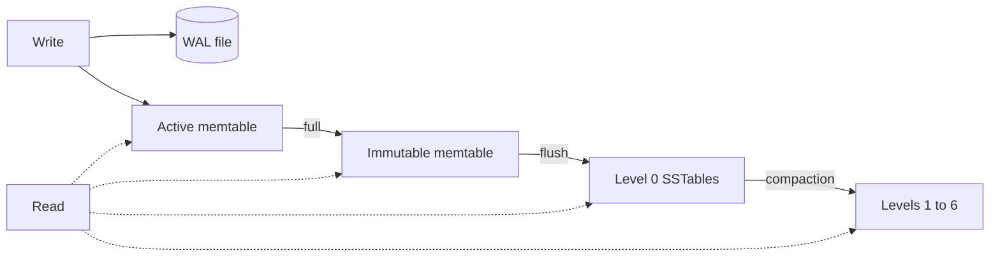

# Solarium

Solarium is an embedded key-value store for .NET, written in managed code. Its design and its API follow [RocksDB](https://rocksdb.org/). A database is one directory on disk. Your process opens it, reads it, and writes it directly. There is no server and no network protocol.

Solarium exists to be a durable log store for [Kommander](https://kahunakv.github.io/kommander.github.io/), the Raft library for .NET. It covers the part of RocksDB that the Raft log of Kommander uses, and RocksDB is the reference behavior. A host can plug Solarium into Kommander in place of RocksDB, with no native library.

:::note A young database
Solarium is a brand-new database, at version 0.1.0. Its on-disk format can still change. Read [What is not done yet](#what-is-not-done-yet) before you use it for data that you cannot lose.
:::

## In simple terms

If you append each change to a file and call fsync, a write is durable, but a read must scan the whole file. A sorted collection in memory, such as a `SortedDictionary`, reads fast but loses everything in a crash. Solarium combines the two:

1. A write goes first to a **write-ahead log (WAL)**, a file that only grows. After a crash, the WAL tells the database what to replay.
2. The write then goes into a **memtable**, a sorted structure in memory.
3. When the memtable is full, a background thread writes it to disk as a **sorted string table (SSTable)**, a sorted file that never changes after it is written.
4. A background **compaction** merges SSTables, so that old versions and deleted keys go away and reads search fewer files.
5. A read searches the memtables first, then the SSTables from the newest to the oldest. The first version of the key that it finds is the answer.



This design makes writes fast, because a write is one append and one insert in memory. It makes crash recovery simple, because the WAL holds every write that is not in an SSTable yet.

## What you get

| Feature | What it means for you |
| --- | --- |
| **Column families** | Named, ordered key spaces in one database, like separate tables in one SQLite file. They share one WAL, so one batch can write to several of them atomically. |
| **Atomic write batches** | A `WriteBatch` applies all its puts, deletes, and range deletes, or none of them, like a transaction that only writes. |
| **Synced and unsynced writes** | A synced write survives a power loss when `Write` returns. An unsynced write survives a process crash. |
| **Range deletes** | `DeleteRange` deletes a key range with one range tombstone, not one delete for each key. |
| **Ordered iterators** | Seek, step forward, step back, and stop at an upper bound. |
| **Leveled compaction** | The seven levels of RocksDB, with its dynamic level sizing. |
| **Checkpoints** | A consistent copy of the database in a new directory, with hard links to the SSTables. |
| **Group commit** | Writes from many threads share their WAL appends and flushes. |
| **Lock-free reads** | Reads take no locks, on a lock-free skip-list memtable. |
| **Storage environments** | All file I/O goes through an interface. The default works everywhere. An io_uring storage environment is available for Linux. |

Every member is safe to call from any thread.

## Packages

| Package | What it is |
| --- | --- |
| `Solarium` | The store. Pure managed code, on every platform that .NET 10 runs on. |
| `Solarium.IoUring` | A storage environment for Linux 6.1 or later that does its file I/O through io_uring, on the [ioxide](https://github.com/MDA2AV/ioxide) runtime. |
| `Solarium.Kommander` | `SolariumWAL`, a Kommander `IWAL` on Solarium, with the on-disk layout of the `RocksDbWAL` of Kommander. |
| `Solarium.Kahuna` | A [Kahuna](https://kahunakv.github.io/) storage engine: the persistence backend and the Raft WAL on Solarium. A Kahuna server loads it with `--extension-assembly`. |

All four packages are MIT-licensed and at version 0.1.0.

## A first look

```csharp
using System.Text;
using Solarium;

using SolariumDb db = SolariumDb.Open("./data",
    new DbOptions { CreateMissingColumnFamilies = true },
    columnFamilies: ["metadata"]);

ColumnFamily metadata = db.GetColumnFamily("metadata");

// All or nothing, across column families. Synced, so it survives a power loss once Write returns.
db.Write(new WriteBatch()
    .Put("log:0001"u8, "entry"u8)
    .Put("last"u8, "0001"u8, metadata),
    WriteOptions.Synced);

byte[]? value = db.Get("log:0001"u8);

using Iterator iterator = db.NewIterator(options: new ReadOptions { IterateUpperBound = "log;"u8.ToArray() });
for (iterator.Seek("log:"u8); iterator.Valid(); iterator.Next())
    Console.WriteLine(Encoding.UTF8.GetString(iterator.Key()));

db.DeleteRange("log:0000"u8, "log:0001"u8);
```

[Getting Started](getting-started.md) explains each line of this example.

## What is done

- The embedded API, column families, atomic batches across them, `DeleteRange`, and iterators with an upper bound.
- Group commit with pipelined writes, and lock-free reads on a skip-list memtable.
- WAL recovery that cuts a torn tail and refuses damage to flushed data. Power-loss tests and kill tests check it.
- Memtable flushes to SSTables, LZ4 block compression, WAL rotation with a size cap, the manifest, leveled compaction into the seven levels of RocksDB with its dynamic level sizing, up to `MaxBackgroundCompactions` compactions at once, a rate limiter and `BytesPerSync` for flushes and compactions, `DeleteFilesInRange`, checkpoints, and write stalls.
- The RocksDB properties and the live-file metadata that Kommander reads.
- `Solarium.Kommander`. It passes the conformance suite of Kommander for WAL backends and the behavior tests of its RocksDB backend. It runs three-node Kommander clusters in the tests and publishes the engine `raft.wal.*` metrics.
- `Solarium.Kahuna`, a port of the RocksDB persistence backend of Kahuna that passes its behavior tests.

## What is not done yet

- **Recovery from an engine failure without a reopen.** After a WAL, flush, or compaction failure, the database refuses all writes until you open it again. `SolariumWAL` reopens it automatically.
- **A shared block cache and memtable budget.** Solarium has no block cache. The page cache of the operating system is the only cache.
- **Subcompactions and more than one flush thread.** One merge always runs on one thread, as with `max_subcompactions` of 1 in RocksDB. Flushes have one thread.

## Where to go next

| If you want to | Read |
| --- | --- |
| Know why Solarium exists and when to use it | [Why Solarium](why-solarium.md) |
| Open a database and write your first batch | [Getting Started](getting-started.md) |
| Use Solarium as the Raft log of Kommander | [Solarium.Kommander](integrations/kommander.md) |
| Run a Kahuna node on Solarium | [Solarium.Kahuna](integrations/kahuna.md) |
| Know what a write survives | [Durability](operations/durability.md) |
| Look up a member or an option | [API Reference](reference/api.md) and [Options](reference/options.md) |
| Know how the engine works inside | [Architecture Overview](architecture/overview.md) |
