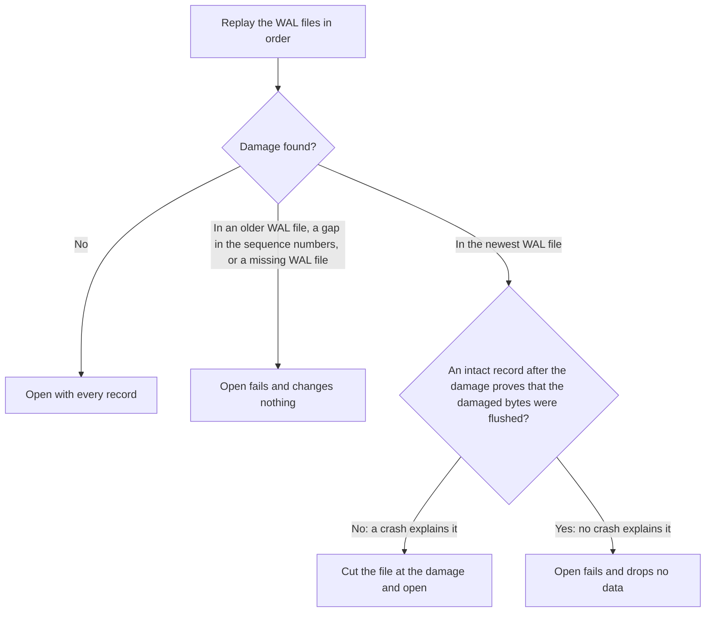

# Durability

This page tells you what a write survives, and what the database does at open after a crash or a power loss. [WAL and Recovery](../architecture/wal-and-recovery.md) explains the file format and the exact rules.

## What a write survives

| Event | Synced write | Unsynced write |
| --- | --- | --- |
| Process crash, after `Write` returns | Survives | Survives |
| Power loss, after `Write` returns | Survives | Can be lost |
| Power loss, after a clean `Dispose` | Survives | Survives |
| Crash during `Write` | The batch is there whole, or not at all | The batch is there whole, or not at all |

The reasons:

- A **synced** write (`WriteOptions.Sync`) flushes the WAL to the device before `Write` returns.
- An **unsynced** write is in the WAL file in the operating system when `Write` returns. The operating system keeps it when the process dies, but a power loss can lose it. This is the same as in RocksDB.
- `Dispose` flushes the current WAL file. So after a clean close, every write survives a power loss. RocksDB does not do this: its unsynced writes need `SyncWAL` before the close.
- A batch is one WAL record with a checksum. Recovery replays a record whole, or drops it whole.

## A crash and a power loss are different

- A **process crash** can only cut the last write short. The operating system keeps everything else that the process wrote.
- A **power loss** can lose any sector written since the last flush, in any order. So the newest WAL file can end with damage that has intact records after it.

Solarium tells these two cases apart. Each WAL record carries the **durable offset** of its file: how much of the file a completed flush made durable when the record was appended.

## What recovery does at open

At open, the WAL files replay in order, and the entries that an SSTable already holds are skipped. Then recovery decides what to do with any damage that it finds:



The open also fails, and changes nothing, for a directory with data files but no `MANIFEST`. A crash during a flush or a compaction leaves orphan files, and the next open deletes them. [WAL and Recovery](../architecture/wal-and-recovery.md#recovery-rules) gives the exact rules. Damage in the WAL or the manifest throws `SolariumException` with `IsCorruption` set.

## The one case that can drop a synced write

The cut can drop a synced write only in one case: flushed data was damaged in a way that no crash causes, and no record was written after it. That is damage inside the last synced group of the file, with nothing appended since. Then nothing in the file shows that the group was flushed.

RocksDB has two recovery modes for this case:

- `TolerateCorruptedTailRecords`, which Kommander uses, fails the open after any power loss that left such a hole.
- `PointInTimeRecovery` drops everything after the first damage, whatever its cause.

Solarium opens after every kind of power loss that its tests simulate, and fails only on damage that no crash explains.

## Damage to an SSTable

A misdirected write can put a whole, valid block at the place of another block. A copy can replace a table file with another valid table. Each block then passes a plain checksum, and a read could answer "not found" for a key that the store holds. Solarium checks each table and each block against the place where it must be, and reports a mismatch as **corruption**.

A crash or a power loss does not explain this damage. A table file is written once, flushed before the manifest names it, and never written again. So recovery cuts nothing here, and a retry fails the same way. The data must come from another copy:

```csharp
try
{
    byte[]? value = db.Get("user:42"u8);
}
catch (SolariumException exception) when (exception.IsCorruption)
{
    // The message names the file and the offset. A retry fails again.
}
```

`IsCorruption` is false for a failure of the storage itself, such as a full disk. An exception that wraps a corruption, such as a write refused after a compaction met one, is a corruption too.

| When | What is checked |
| --- | --- |
| At open, for each table | The footer: its magic number, version, and CRC-32. Every block except the data blocks, against its checksum. Each index partition, against the key that the top-level index holds for it. Then the table against its record in the manifest: the table id, the size, the entry count, the sequence numbers, and the key range. |
| At each read of a data block from the file, by `Get`, `MultiGet`, an iterator, or a compaction | The checksum of the block. Its last key, which must equal its index entry. Its first key, which must come after the block before it. Every length, count, and entry kind that the read decodes. |

What happens when a check fails:

- **An open** fails when a table is not the one that the manifest records. This happens before the open replays the WAL or saves the manifest, so every file that the manifest lists stays as it was.
- **A read** fails, and nothing else changes. Other keys still read.
- **A compaction** stops the writes of the database, as any compaction failure does. See [Storage Failures](storage-failures.md#corruption).

The limits of these checks:

- A table written before table version 5 has no table id, and its checksums are not bound to the table or the offset. The key checks still find a misplaced block, and the open still compares the other fields of the record.
- In a version 5 data block, the check decodes the first and the last entries only. The entries between them are decoded, and refused if they do not decode, when a read reaches them.
- A block in the block cache is not checked again. It passed these checks before it went in.

[SSTables](../architecture/sstables.md#how-a-table-proves-its-place) explains how the checksums are bound.

## After a failure while running

A WAL, flush, or compaction failure stops all later writes until you open the database again. After a failed append, the tail of the WAL is unknown, so the database does not write after it. Reads continue. See [Storage Failures](storage-failures.md).

## How it is tested

The [power-loss tests and the kill tests](testing.md) check these rules. They cut the power or kill a process at random points of a random workload, reopen the database, and check that it holds exactly the batches that it must hold.
