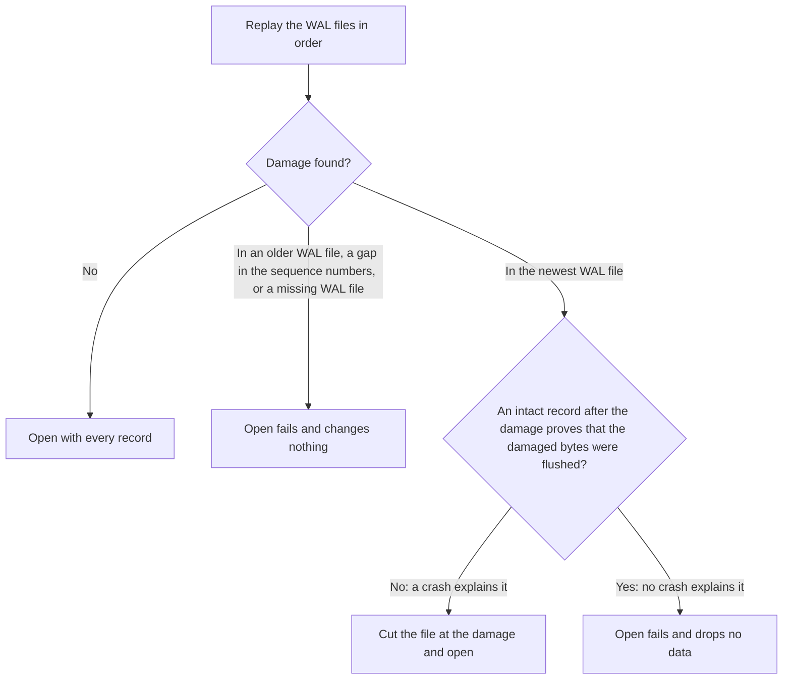

# Durability

This page tells you what a write survives, and what the database does at open after a crash or a power loss. [WAL and Recovery](../architecture/wal-and-recovery.md) explains the file format and the exact rules.

## What a write survives

| Event | Synced write | Unsynced write |
| --- | --- | --- |
| Process crash, after `Write` returns | Survives | Survives |
| Power loss, after `Write` returns | Survives | Can be lost |
| Power loss, after a clean `Dispose` | Survives | Survives |
| Crash during `Write` | All of the batch is there, or none of it | All of the batch is there, or none of it |

The WAL explains these results. A write is in the WAL before `Write` returns.

- A **synced** write (`WriteOptions.Sync`) flushes the WAL to the device before `Write` returns.
- An **unsynced** write is in the WAL file in the operating system when `Write` returns. It survives when the process dies, but a power loss can lose it. This is the same as in RocksDB.
- `Dispose` flushes the current WAL file. This means that after a clean close, every write survives a power loss. In RocksDB, unsynced writes need `SyncWAL` before the close.
- A batch is one WAL record with a checksum. Recovery replays all of a record, or drops all of it.

## Process crash and power loss

- A **process crash** can only cut the last write short. Everything else that the process wrote survives in the operating system.
- A **power loss** can lose any sector written since the last flush, in any order. This means that the newest WAL file can end with damage that has intact records after it.

Solarium tells these two cases apart. Each WAL record carries the **durable offset** of its file: how much of the file a completed flush made durable when the record was appended.

## What recovery does at open

At open, the WAL files replay in order. The replay skips the entries that are already in an SSTable. When recovery finds damage, its place in the WAL decides the result.



The open also fails for a directory with data files but no `MANIFEST`, and changes nothing. A crash during a flush or a compaction leaves orphan files, and the next open deletes them. [WAL and Recovery](../architecture/wal-and-recovery.md#recovery-rules) gives the exact rules. Damage in the WAL or the manifest throws `SolariumException` with `IsCorruption` set.

## Damage in the last synced group

The cut drops a synced write in one case only. Flushed data of the last synced group of the file was damaged in a way that no crash causes, and no record was written after that group. The file then does not show that the group was flushed. A WAL file cut after its fsync is one such case.

To find this case, keep a proof outside the WAL. After a synced write, [`WriteBatch.GroupLastSequence`](../guides/writes-and-batches.md#know-what-a-synced-write-made-durable) tells which sequence numbers are durable. At open, compare the number that you recorded with `LatestSequenceNumber`. [`SolariumWAL`](../integrations/kommander.md#storage-damage) does this with its sync ledger.

RocksDB has two recovery modes for this case, `TolerateCorruptedTailRecords` and `PointInTimeRecovery`.

- `TolerateCorruptedTailRecords`, which Kommander uses, fails the open after any power loss that left such a hole.
- `PointInTimeRecovery` drops everything after the first damage, whatever its cause.

Solarium opens after every kind of power loss that its tests simulate, and fails only on damage that no crash explains.

## Damage to an SSTable

A misdirected write can put a complete, valid block at the place of another block. A copy can replace a table file with another valid table. Each block then passes a checksum of its bytes, and a read could answer "not found" for a key that is in the store. Solarium checks each table and each block against the place where it must be. A mismatch is **corruption**.

A crash or a power loss does not explain this damage. A table file is written once and flushed before the manifest names it, and it does not change after that. Recovery does not cut anything here, and a retry fails the same way. You must take the data from another copy, and `IsCorruption` tells you when.

```csharp
try
{
    byte[]? value = db.Get("user:42"u8);
}
catch (SolariumException exception) when (exception.IsCorruption)
{
    // The message names the file and the offset. A retry fails again.
}
```

`IsCorruption` is false for a failure of the storage itself, such as a full disk. Some exceptions wrap a corruption, for example when a write fails after a compaction met one. `IsCorruption` is true for those too.

| When | What is checked |
| --- | --- |
| At open, for each table | The footer: its magic number, version, and CRC-32. The checksum of each block that is not a data block. Each index partition, against its key in the top-level index. Then the table against its record in the manifest: the table id, the size, the entry count, the sequence numbers, and the key range. |
| At each read of a data block from the file, by `Get`, `MultiGet`, an iterator, or a compaction | The checksum of the block. Its last key, which must equal its index entry. Its first key, which must come after the block before it. The lengths and counts that the read decodes, and the entry kinds. |

The result of a failed check depends on the operation.

- **An open** fails when a table is not the one that the manifest records. This happens before the open replays the WAL or saves the manifest. The files that the manifest lists do not change.
- **A read** fails. This does not change the database, and reads of other keys work.
- **A compaction** stops the writes of the database, as any compaction failure does. See [Storage Failures](storage-failures.md#corruption).

These checks have limits for older tables, for the middle of a block, and for cached blocks.

- A table written before table version 5 does not have a table id, and its checksums are not bound to the table or the offset. The key checks find a misplaced block in such a table too, and the open compares the other fields of the record.
- In a version 5 data block, the check decodes the first and the last entries only. A read that reaches the entries between them decodes them, and fails if they do not decode.
- A block in the block cache is not checked again. It passed these checks before it went in.

[SSTables](../architecture/sstables.md#how-a-table-proves-its-place) explains how the checksums are bound.

## After a failure while running

A WAL failure stops all later writes until you open the database again. A flush failure and a compaction failure have the same effect. After a failed append, the tail of the WAL is unknown, and the database does not write after it. Reads continue. See [Storage Failures](storage-failures.md).

## How it is tested

The [power-loss tests and the kill tests](testing.md) check these rules. They cut the power or kill a process at random points of a random workload. After a reopen, they check that the database has exactly the batches that it must have.
